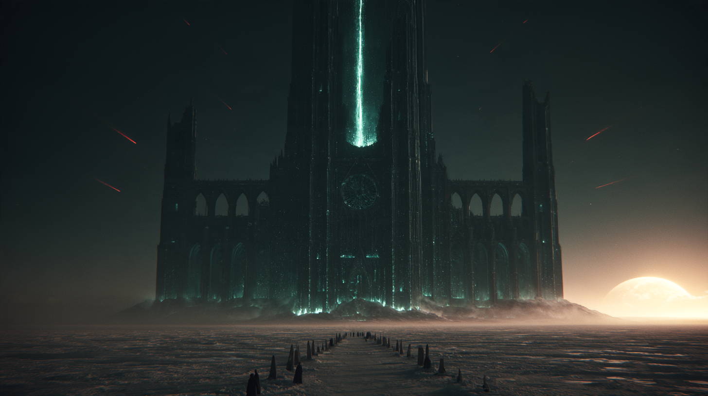

# Ay Kuyusu Katedrali — *Kara Katedral*

> *Karanlık yüzün kıyısında, içinden ışık sızan kara bir katedral. Herkes orada tanrıçanın göründüğünü söyler.*

**Yukarı:** [Bölgeler](../README.md) · [Black Still](../black-still.md) ·
**Bu klasör:** 🔒 [Dungeon](01-dungeon.md) · 🔒 [Sırlar](05-secrets-dm-only.md) ·
**Oyunda:** [Session 06 §8](../../../06-campaigns/new-campaign/sessions/session-06-besinci-saat.md#8-ana-görev--ay-kuyusu-katedrali) · **Görev:** [Kök](../../../06-campaigns/new-campaign/quests/quest-the-root.md)


*Oyunculara göster: ufukta ilk gördüklerinde. (Midjourney, DM'in hesabı, 2026-11-12; [prompt](#görsel-promptu))*

## Kimlik kartı

| | |
|---|---|
| **Adlar** | Halk: **Ay Kuyusu**, **Kara Katedral** · Elfçe: *Shaen'Thalas* ⬜ *(anlam önerisi: "ayın kuyusu")* |
| **Nerede** | [Stillreach](../stillreach/README.md)'in 24 mil ötesi, karanlık yüze doğru. **Don-88** taşından sapan hacı yolu, 2 mil |
| **Ne** | [Selûne](../../../02-lore/pantheon/faerunian/selune.md) katedrali. Altında bir kuyu: **Ay Kuyusu** |
| **Kim tutuyor** | 8 [Bearfolk bekçi](../../../02-lore/bestiary/bearfolk-warden.md). Başları **Yorga** |
| **Kim kamp kurdu** | [The First Communion](../../../06-campaigns/new-campaign/factions-in-play/the-four-answers/the-first-communion.md): **Ysolde Marr**, [Ilrien](../../../05-characters/npcs/minor/the-first-communion/ilrien.md), 4 Geçen, 2 Dinleyici |
| **Büyü** | Hattın en yoğun ham büyüsü: vahadan sonra ikinci |
| **Tehlike** | Yüksek. Soğuk, ham büyü, kuyudan doğanlar |

## Uzaktan

- **Biçim:** Düz kara buzun ortasında geniş, yayvan, **ortaçağ katedrali:** uzun nef, haç planı, payandalar, iki kat sivri kemer, gül penceresi. Ortada dev bir **ana kule,** iki yanda birer ince kule (kuzeydeki yarım).
- **Yarık:** Ana kulenin cephesi yukarıdan aşağı çatlamış; çatlaktan **ışık sütunu** sızıyor. Kuyunun tam üstü.
- **Kat:** Yerden yukarı üç *(nef, galeri, çan kulesi)*, aşağı iki *(kripta, kuyu)*.
- **Taş:** Kara; buz değil, taş. Üstünde kar tutmuyor.
- **Işık:** Derzlerden, pencere kemerlerinden, payanda diplerinden sızan **soluk mavi-yeşil damarlar.** Yosun ya da mantar ışığı gibi; değil. Charaxis'te yosun yok. Ağır ağır soluk alır gibi parlayıp söner.
- **Gök:** Yıldız az, kuyruklu yıldızlar kızıl. Katedralin tepesinde gök bir tık **daha karanlık.**
- **Ses:** Yok ([Don-70 ötesi](../black-still.md#masada-okunacak)). Çan kulesi var, çan sesi yok.
- **His:** Yaklaştıkça [rün](../../../08-rules/homebrew/items/watch-runes.md) kaşınır. Büyücülerin dişi sızlar.

### Görsel prompt'u

Midjourney, [Stil A](../../../06-campaigns/new-campaign/factions-in-play/the-four-answers/art-prompts.md):

```
cinematic film still from a grimdark fantasy epic, shot on 35mm anamorphic, extreme wide establishing shot, a vast black gothic medieval cathedral standing alone on an endless flat plain of black ice under a starless night, wide and sprawling, long nave, flying buttresses, two western towers one of them broken and unfinished, several storeys of dark pointed arches, the black stone veined with faint blue-green bioluminescent light seeping from the mortar joints and the empty rose window and the arched windows, glowing softly like deep-sea creatures, no fire, no torches, a line of small standing stones leading to its doors, a few tiny cloaked travellers in the foreground for scale, thin red comet trails low in the black sky, a huge pale planet low on the horizon, cold mist over the ice, silent, sacred and wrong --ar 16:9 --raw --s 80 --exp 15 --no cartoon, anime, illustration, trees, daylight, snow on the roofs
```

## Tarih

| Ne zaman | Ne |
|---|---|
| Çok eski | [Ölü uygarlık](../../00-overview/inhabitants.md#ölü-uygarlık) burada bir **kuyu** kazdı. Ne için, bilinmiyor |
| 1385 sonrası | Kapıları sabitleyen Silvaerûn elfleri ve Selûne hacıları kuyuyu **Moonwell** saydı; üstüne katedrali kurdular ⬜ |
| 1385–1494 | Hac yeri. On iki rahip, yüz kadar hacı yatağı. Stillreach'in [Ay Çukuru](../stillreach/places.md#ay-çukuru) buranın yoksul kopyası |
| **1494** | ☄️ Tanrılar sustu. Hacı kesildi. Rahipler **gitmedi** |
| **1495** | Katedralde ayı kılıklı bekçiler görüldü. Silüet söylentisi başladı |
| **~26 Uktar 1495** | Communion kuyunun başına kamp kurdu |

## Stillreach'te ne söylenir

> Parti sorarsa. Her biri **bir kişiden,** bir cümle. Doğrusu → 🔒 [sırlar](05-secrets-dm-only.md).

| Söylenti | Kimden | Doğru mu |
|---|---|---|
| ⭐ **Selûne'nin silüeti orada hâlâ görünüyor.** Apsiste, kuyudan yükselen ışıkta; yüzü yok | [Ay Çukuru](../stillreach/places.md#ay-çukuru)'na gelenler · [Tuk](../stillreach/people.md#tuk) | 🔒 Görünen bir şey var |
| ⭐ **Ayı halkı artık oranın bekçisi.** Hacıya dokunmuyor, silah bağlatıyor | [Sorka](../../../05-characters/npcs/minor/sorka-ucdis.md) *(anlatmaz; sorulunca susar)* · kızakçılar | ✅ |
| Rahipler hâlâ orada, **oturuyor** | [Emmer Tolland](../stillreach/people.md#emmer-tolland): *Depo'ya hiçbiri gelmedi* | 🔒 |
| Oraya giden **dilediğini görüp** dönüyor; dönen bir daha aşağı inmek istemiyor | [Gri Oda](../stillreach/places.md#gri-oda) müşterileri | 🔒 Yarı doğru |
| Bir hafta önce Bent'ten **gri giyimli elfler** geçti; pul göstermediler, nöbet onları **hatırlamıyor** | [Tolga Erden](../stillreach/people.md#tolga-erden) | ✅ Communion |
| [Saatçiler](../../factions.md#saatçiler--the-hourwrights) oraya **gitmez** | [Perrel Soan](../stillreach/people.md#perrel-soan) | ✅ Ölçüleri orada tutmuyor |

## Yol

| | |
|---|---|
| **Mesafe** | Stillreach → Don-88: 24 mil yol üstü + 2 mil yol dışı |
| **Yaya** | 2 gün *(8 kol)*. **Ölümcül soğuk:** rünsüz saatte DC 15 Con. Rün taşıyana işlemez |
| **Kızak** | 1 gün. [Sorka](../../../05-characters/npcs/minor/sorka-ucdis.md) götürür, Don-88'de **bırakır;** kurtlar hacı yoluna girmez |
| **İzin** | Bent'ten kuzeye çıkış [İmtiyaz](../../factions.md#soğuk-i̇mtiyaz--the-cold-concession) izni ister. Ya da nöbet **bakmazken** |
| **Rün sayacı** | Gidiş-dönüş + katedral ≈ **4–5 gün.** 10 günün yarısı |
| **Yolda** | Don-70: ses biter · Don-88: yoldan sapan taş dizisi, her taşta hilal |

## İçerisi — özet

| Kat | Ne | Kim |
|---|---|---|
| **Dış** | Hacı yolu, ön avlu, batı kapısı | 3 bekçi |
| **Nef katı** | Narteks, büyük nef, dört evre şapeli, ocak, apsis | 5 bekçi; silüet |
| **Üst kat** | Galeri, yazıhane, çan kulesi | Phase Spider'lar; bir Geçen gözcü |
| **Kripta** | Rahipler mahzeni, kemik koro, su kemeri | On iki rahip; kuyudan doğanlar |
| **Kuyu** | Communion kampı, Ay Kuyusu | Marr, Ilrien, cemaat |

Oda oda → 🔒 [01-dungeon.md](01-dungeon.md).

## Kancalar

> **[HOOK]** [Grimgor](../../../05-characters/player-characters/new-campaign/grimgor/README.md): tanığının **göründüğü** söylenen yer. Davasını yüzüne söyleyebileceği tek adres.

> **[HOOK]** [Gwyndor](../../../05-characters/player-characters/new-campaign/gwyndor/README.md): susan tanrılardan biri burada görünüyorsa, yemini kime ettiğini sorabilir.

> **[HOOK]** Communion'ın peşindeki herkes için: [Session 06](../../../06-campaigns/new-campaign/sessions/session-06-besinci-saat.md#5-sorgu--kim-ne-biliyor)'daki sorgunun son basamağı burayı gösterir.
