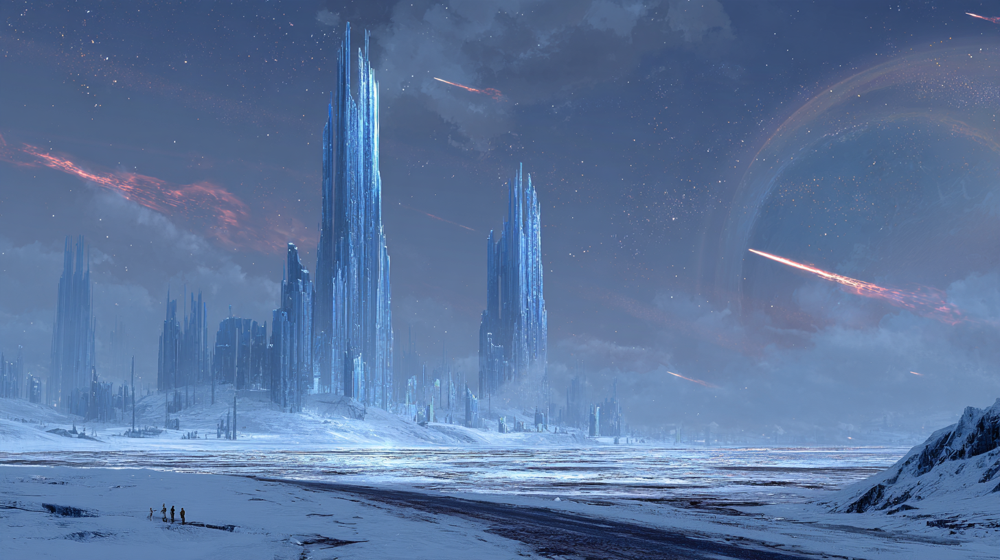

# Stillreach

> *"Burada iki nüfus var ve büyük olanı konuşmuyor."*

**Yukarı:** [Bölgeler](../README.md) · **Taş:** Don-64 ·
**Portal:** [K-1 → Soğuk Basamak](../../planar-sites/README.md#soğuk-basamak--k-1)

**Bu klasör:** [Mekânlar](places.md) · [Kadro](people.md) · [Görevler](quests.md) ·
🔒 [Sırlar](05-secrets-dm-only.md)

## Kimlik kartı

| | |
|---|---|
| **Nerede** | [Black Still](../black-still.md) sınırı. Don-64; yolun ötesinde 31 taş daha var, sonra hiçbir şey |
| **Nüfus** | ~2.900 canlı. **4.100 kayıtlı ölü** — buzda, bozulmadan |
| **Kim** | ~2.000 Ravonyalı borçlu · **~600 ork** · ~180 Karsovyalı · ~40 [Saatçi](../../factions.md#saatçiler--the-hourwrights) · ~80 diğer |
| **Yönetim** | [Soğuk İmtiyaz](../../factions.md#soğuk-i̇mtiyaz--the-cold-concession) — Karsovia tacının şirketi |
| **Ekonomi** | **Yanar buz** · **pres buzu** (denge yükü) · Chronoshard işleme · soğuk depo · mezar arşivi kazısı · yasak deney |
| **Tehlike** | Yüksek. Soğuk, Saatçiler, İmtiyaz ve Ocak sırayla öldürür |

## İlk izlenim

*Buzdan yaklaşırken: büyütülmüş kuleler, kızıl kuyruklu yıldızlar, ufukta Ager.*

> Stillreach donmuş kulelerden oluşur ve kuleler yapılmamış, **büyütülmüş** gibi
> durur: buz taşından, çatlaksız, içeriden soluk mavi bir ışıkla. Bacaları
> tüter ama duman yükselmez — havada asılı kalır, kule boyunca yanlamasına yayılır.
>
> Sokaklarda insanlar hızlı yürür. Hiçbiri koşmaz. Koşmak burada terlemek
> demektir ve terlemek ölmek demektir.
>
> Şehrin en kalabalık yeri meydan değil, **depodur**: buzun içine oyulmuş, sıra
> sıra nişler ve her nişte bir beden. Alınlarına vardiya pulu yapıştırılmıştır.
> Depo bekçisi ziyaretçi kabul eder, defter tutar, ücret alır. En eski beden
> yüz on iki yaşındadır ve dünkü kadar tazedir.
>
> Ve arada bir — düzensiz aralıklarla — biri sana geçen kolun ne kadar sürdüğünü
> sorar. Cevabını dikkatle dinler. Sonra teşekkür eder.

## Kapağın altında — *şehir içeriden*

> Kuleleri uzaktan görürsün. **İçeri girince bir daha görmezsin.**
>
> Elli fit yukarıda gökyüzü biter. Tavan ıslak yün gibi siyah, ağır ve alçak:
> binlerce baca, hiç yükselmeyen duman. Buna **Kapak** derler. Ağzında is, dişinin
> arasında buz tozu, kirpiğinde kül. Fenerler öğlen de yanar — burada öğlen yok.
>
> Otuz adım ötesi gri, yüz adım ötesi yok. Sokaktaki biri önce ses olur: zincir,
> kızak demiri, bir öksürük. Sonra bir fener. Sonra bir ork, sırtında kendisi kadar
> buz bloğu, sana bakmadan geçer. Ayağının altında her şey hafifçe titrer —
> Pres Hanesi vuruyor. Bütün şehir o vuruşla nefes alır.
>
> Ve kokusu: yanmış yağ, eski ter, çok uzaktan gelen tuhaf tatlı bir şey. O
> tatlı koku moondust. Herkes bilir. Kimse söylemez.

### Şehir neyle yaşıyor

Stillreach'in vitrini zaman ürünleridir ama **karnını doyuran buzdur.**

| Ne | Nasıl | Nereye gider |
|---|---|---|
| **Yanar buz** | Siyah buzun derin katmanındaki gazlı, yağlı damar. Kesilir, kazana atılır, **pis ama sıcak** yanar. Kapak'ın sebebi | Şehrin bütün ısısı; Widowsilver hattı |
| **Pres buzu** | Temiz buz, buhar presleriyle sıkıştırılır | [Denge yükü](../../mining/README.md#denge-yükü) — Kül yarısının hayatta kalması bunun sırtında |
| **Chronoshard** | [Yavaş Çukur](../../mines/slow-pit.md)'dan gelir, [Saat Salonu](places.md#saat-salonu)'nda işlenir | Taç, zenginler, kara pazar |
| **Depo ücreti** | Göz başına beden başına 2 pul | Şirket hanesi. Ölmek borcu bitirmez |
| **Arşiv kazısı** | İmtiyaz izniyle eski mezarlar | Resmen "tarih", gerçekte → 🔒 [sırlar](05-secrets-dm-only.md) |

> **Yanar buz bir patlayıcıdır.** Ocak'ta ve Kazan Sırası'nda en çok korkulan
> kelime bu yüzden **"kör patlak"**: kesilen damarın gaz cebine denk gelmesi.

### Masa kuralları — Kapak altı

> Mekanik metin; masada kısa söyle.

| Kural | Mekanik |
|---|---|
| 🌫️ **Görüş** | 30 ft net · 30–100 ft **Lightly Obscured** · 100 ft ötesi **Heavily Obscured.** Darkvision bunu delmez — bu karanlık değil, is |
| 🌑 **Kapak iner** | Vuruşta **d6: 1** → o kol boyunca 30 ft ötesi Heavily Obscured. Herkes bir eli önündekinin omzunda yürür |
| 😮‍💨 **Kara öksürük** | Kapak altında maskesiz uzun dinlenme: **DC 10 Con**, başarısızsa bir sonraki uzun dinlenmeye kadar Stealth ve Perception (koku/ses) **Disadvantage.** Maske: 2 pul |
| ❄️ **Soğuk** | Don-64 — *çok soğuk:* uygun giysi yoksa saatte **DC 10 Con.** [Rün](../../../08-rules/homebrew/items/watch-runes.md) ya da denge yükü kaldırır. Kazan Sırası'nda kural yok |
| 🔇 **Ses** | Şehirde normal. Ses [Don-70](../black-still.md#masada-okunacak)'te biter — ama Kuzey Bent'in ötesinde yolsuz buzda da garip davranır |
| ✨ **Büyü** | Şehir yol üstünde: ceza yok. **Ocak ve galeriler çivisiz:** slot harcayan her büyüde d20, **1** → [cep tablosu](../../mining/README.md#cep-açıldığında--d10). Yolsuz buz: **1–2** → Wild Magic Surge ([ham büyü](../../phenomena/README.md#3-ham-büyü--masa-kuralı)) |
| 🏃 **Koşmak** | Dash atan, sahne sonunda **terlemiş** sayılır: rün/yük yoksa bir sonraki soğuk save'i Disadvantage |

### Fiyatlar

> Pul: şirket parası. Ashkar'da [10 pul ≈ 1 gp](../../mining/README.md); burada bozdurmak **suç**, ama herkes yapıyor (15 pul = 1 gp, [Kumpanya Hanı](places.md#kumpanya-hanı)).

| Ne | Fiyat | Not |
|---|---|---|
| Denge yükü, 1 gün | 2 gp | Hattın en ucuzu — burada yapılıyor |
| Is maskesi | 2 pul | Yünden, kirli. İkinci gün dişlerin siyah |
| Kazan Sofrası, bir tas | 1 pul | Sıcak. İçindekini sorma |
| Depo gözü | 2 pul / Göz | Ölünün borcundan düşülür |
| Depo ziyareti | 1 pul | Bekçi deftere yazar |
| Gri Nefes, bir üfürük | 3 pul | [Moondust](../../README.md#️-moondust--gri-nefes) — Kumpanya'nın tek indirimli malı |
| Elmas, 25 gp'lik | 25 gp *([Emanet](places.md#stok), stok 3)* / 40 gp *(Saatçi)* / 30 gp + bir soru *(Kumpanya)* | ⚠️ *Battle Familiar* bileşeni. Burada az bulunur |
| Gecikme camı | 300 gp | [Saatçiler](#saatçiler) |
| Sayılmayan saat | 150 gp | **Yasa dışı** |
| Uzun bekleme | 900 gp | |

### Kim neresinde

| Halk | Sayı | Nerede görürsün | Ne yapar |
|---|---|---|---|
| **Ravonyalılar** | ~2.000 | Aşağı Sıra, Ocak'ın alt terasları, depo | Kazar. Silahsız. Borçlu. *Çoğu bir zamanlar birbirini "çavuşum" diye çağırıyordu* |
| **Orklar** | ~600 | **Her yerde, yüzeyde** — kızak, vinç, kazan, makine | Yüzeyde gördüğün her iki kişiden biri ork. Ravonyalıya makine ve kızak emanet edilmez |
| **Karsovyalılar** | ~180 | Kışla, komiserlik, Kapak'ın üstü | 140 asker, 40 memur. Sayıyor |
| **Saatçiler** | ~40 | Saat Salonu, Kapak'ın üstü | İşler, satar, sorar |
| **Diğer** | ~80 | Hanlar, Kumpanya, tartı | Cüce tartıcılar · Ashkarlı kaçakçılar · birkaç tiefling kazancı |

> ⭐ **Sınıf çizgisi dikeydir.** Kuleler Kapak'ı deler. **Üst kat** temiz havadır:
> yıldızlar, Ager, soluk mavi ışık. Karsovyalılar ve Saatçiler orada yaşar.
> Aşağıdaki iki buçuk bin kişinin çoğu **Göz'ü (Ager'i) aylardır görmedi.**

## Orklar — *neden bu kadar çok*

[Soğuk İmtiyaz](../../factions.md#soğuk-i̇mtiyaz--the-cold-concession), iki bin eski Ravonya
askerine kazma verebilir ama **makine, kızak ve patlayıcı veremez.** Bu işler için
ork kiralıyor — ve [Ager'deki üç ork gücünün](../../../06-campaigns/new-campaign/factions-in-play/orc-factions.md) üçü de burada,
üçü de birbirini küçümsüyor.

| Grup | Sayı | İş | Nasıl geldiler | Yüzü |
|---|---|---|---|---|
| ⚙️ **[Demirdiş](../../../06-campaigns/new-campaign/factions-in-play/orc-factions.md#2-demirdiş-klanı--entegre-olanlar) makinistleri** | ~150 | Buz kesiciler, vinçler, kazan bakımı | Sözleşmeli, **gp ile** ücretli. Kendi aralarında cücece konuşurlar | [Bralga Ormak](../../../05-characters/npcs/minor/bralga-ormak.md) |
| 💰 **[Gharuk](../../../06-campaigns/new-campaign/factions-in-play/orc-factions.md#1-gharuk-kumpanyası--tüccarlar) sözleşmelileri** | ~300 | Kızak, hamallık, ateşçilik | Kumpanya yol parasını verdi; %6 ile ödüyorlar. Rakibine **adam kiralıyor:** iş iştir | [Urzha Keth](../../../05-characters/npcs/minor/urzha-keth.md) |
| 🐺 **[Kırık Boynuz](../../../06-campaigns/new-campaign/factions-in-play/orc-factions.md#3-kırık-boynuz--barbarlar) sürgünleri** | ~150 | Kızak kurtları, kuzey seferleri, en kötü teraslar | [Ghorag](../../../06-campaigns/new-campaign/factions-in-play/orc-factions.md#ataman-ghorag) baskını suç ilan etti; hüküm giyenlere iki seçenek: ip ya da Charaxis | [Sorka Üçdiş](../../../05-characters/npcs/minor/sorka-ucdis.md) |
| 📜 **Ataman'ın adamları** | bir avuç | Vardiya arası mektep | Kimse göndermedi — *resmen* | [Ulgar Harfçi](people.md#ulgar-harfçi) |

> **İlk soruları hep aynıdır:** *"Kimin orkusun?"* Yani: hangi defter, hangi klan,
> hangi sözleşme. Hattaki bir ork için cevap vermemek, adını söylememekten daha tuhaftır.

> **[HOOK]** İki bin Ravonyalı **fitil**, yüz kırk Karsovyalı **kibrit.** Şehirde patlama olursa sonucu
> **altı yüz ork** belirler: kızakları, vinçleri, kazanları ve kurtları onlar tutuyor.
> Ve bunu üç ayrı defter tutuyor. → [Görevler — Fitil](quests.md#5-fitil)

## Bölümler

| Yer | Ne |
|---|---|
| [**Soğuk Basamak**](places.md#soğuk-basamak) | K-1 portalı. Karsovia'nın Charaxis'e açılan asıl ağzı |
| [**Kuzey Bent**](places.md#kuzey-bent) | Black Still'e bakan buz seddi. Kuzeyden kimse gelmez |
| [**Büyük Ocak**](places.md#büyük-ocak) | Şehrin yarısını yiyen teraslı buz ocağı |
| [**Pres Hanesi**](places.md#pres-hanesi) | Şehri vuruşla titreten buhar presleri |
| [**Kazan Sırası**](places.md#kazan-sırası) | Ork mahallesi: kazanlar, [Kazan Sofrası](places.md#kazan-sofrası), [Gri Oda](places.md#gri-oda) |
| [**Kumpanya Hanı**](places.md#kumpanya-hanı) | Gharuk'un burnunun dibindeki bürosu |
| [**Emanet Hanesi**](places.md#emanet-hanesi) | 🛒 Sihirli eşya dükkânı: ölü malı, kaçan malı, rehin malı. Pazar fiyatı |
| [**Kurt Ahırı**](places.md#kurt-ahırı) | Kızak kurtları. Vaha seferleri buradan kalkar |
| [**Depo**](places.md#depo) | 4.100 beden. Göz başına 2 pul; borçtan düşülür |
| [**Saat Salonu**](places.md#saat-salonu) | Saatçiler loncası. Chronoshard'ı zaman büyüsüne çeviriyorlar |
| [**Arşiv Kazısı**](places.md#arşiv-kazısı) | Buzun altındaki kadim mezarlar. İmtiyaz izniyle kazılır |
| [**Kışla**](places.md#kışla) | 140 Karsovyalı asker. Hattaki tek düzenli askerî güç |
| [**Aşağı Sıra**](places.md#aşağı-sıra) | Borçluların barakaları. Isıtılmaz; kolektif ısı ile yaşanır |
| [**Ay Çukuru**](places.md#ay-çukuru) | Kimsenin kurmadığı küçük bir ibadet yeri: **aya basanlar** |

## Saatçiler

Chronoshard'ı işleyen lonca. Ne yaptıkları açıkça bilinir, **nasıl** yaptıkları
bilinmez ve sorulduğunda cevap verilmez.

| Ürün | Ne yapar | Fiyat |
|---|---|---|
| **Gecikme camı** | Bir olayı bir saniye geciktirir. Reaction penceresi açar | 300 gp |
| **Sayılmayan saat** | Taşıyanın bir kolu vardiya defterine yazılmaz | 150 gp — **yasa dışı** |
| **Uzun bekleme** | Bir bedeni buzda kalmadan durdurur | 900 gp |

> **[DM ONLY]** Saatçiler Chronoshard'ı işlemiyor — **pazarlık ediyorlar.**
> Yavaş Çukur'un dibinde, kimseye gösterilmeyen bir galeride, madenciler
> "sayılmayan bir vardiya" ile karşılaşıyor: orada kazan bir ekip var,
> defterde yok, ve Saatçiler onlara **ödeme yapıyor.** Neyle ödediklerini
> kimse bilmiyor. Chronoshard bu pazarlığın makbuzu.
> → [the Slow Pit](../../mines/slow-pit.md)

## Soğuk İmtiyaz

Karsovia tacının Charaxis şirketi. K-1 ve K-2 kapılarını, Widowsilver'ı, Kara
Bahçe'nin "kapatılmasını" ve Stillreach'in tamamını işletir.

**İşgücünün %70'i Ravonyalıdır** — Mürai savaşında dağıtılan ordudan.
Kazanan tarafın şirketi, kaybeden tarafın askerlerini kazdırıyor ve bunu
"istihdam" olarak adlandırıyor.

| | |
|---|---|
| **Komiser** | [Kapitan Vidrek Solyan](../../../05-characters/npcs/minor/vidrek-solyan.md) |
| **Ustabaşları** | Ravonyalı gaziler; en bilineni [Ansel Corr](../../../05-characters/npcs/minor/ansel-corr.md) *(Widowsilver)*, şehirde [Halla Venn](people.md#halla-venn) |
| **Kural** | Borç ödenmeden kapıdan geçiş yok. Borç Göz başına **%4** işler |

> **[HOOK]** Barış aylıktır. Stillreach'te iki bin Ravonyalı, yüz kırk Karsovyalı
> askerin gözetiminde, silahsız çalışıyor ve hepsi savaşı yaşamış adamlar.
> Hattaki herkes aynı şeyi biliyor ve kimse söylemiyor: **burası bir kışla değil,
> bir fitil.**

> **[DM ONLY]** Solyan'ın gerçek görevi Chronoshard değil. Karsovia,
> [K-1/K-2 kapılarının](../../planar-sites/README.md) kararsızlaşmasından sonra
> **kendi kapısını yapmanın** mümkün olup olmadığını soruyor ve cevabı
> Stillreach'in mezar arşivinde arıyor. Bunu Saatçiler de biliyor. Onlar da
> aynı arşivi kazıyor, farklı bir sebeple.

## Kişiler

| Kim | Rol | Dosya |
|---|---|---|
| **Kapitan Vidrek Solyan** | Soğuk İmtiyaz komiseri | [→](../../../05-characters/npcs/minor/vidrek-solyan.md) |
| **Ansel Corr** | Widowsilver ustabaşı; Ravonyalı gazi | [→](../../../05-characters/npcs/minor/ansel-corr.md) |
| **Urzha Keth** | Gharuk Kumpanyası'nın Stillreach simsarı | [→](../../../05-characters/npcs/minor/urzha-keth.md) |
| **Bralga Ormak** | Demirdiş baş makinisti | [→](../../../05-characters/npcs/minor/bralga-ormak.md) |
| **Sorka Üçdiş** | Kırık Boynuz sürgünü; kızak kurtlarının sahibi | [→](../../../05-characters/npcs/minor/sorka-ucdis.md) |
| **Diğerleri** | Halla Venn · Emmer Tolland · Ulgar Harfçi · Tolga Erden · Perrel Soan | [people.md](people.md) |
