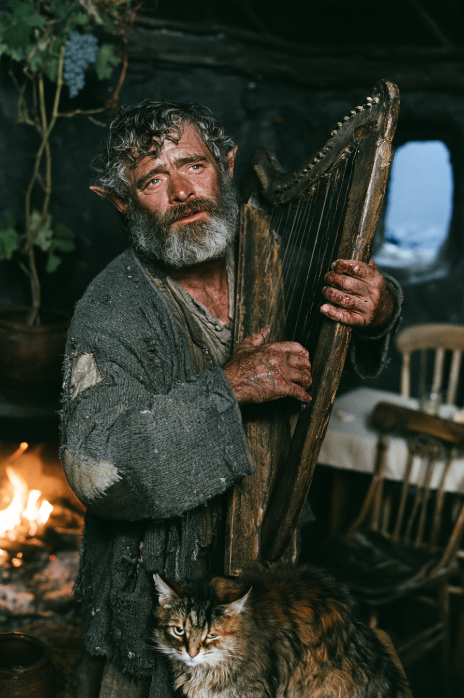

# Calith Auveran — *Geç Kalan*

> *Bir şehir kurdu, adını bıraktı, merdivenlerden indi ve kimsenin gelmediği bir kapıdan yürüdü; yetmiş dört yıldır Kara Dinginlik'te aynı şarkıyı çalıyor.*



**Statblock:** [statblock.md](statblock.md) · 🔒 **Sırlar:** [05-secrets-dm-only.md](05-secrets-dm-only.md) ·
**Evi:** [Geç Kalan'ın Evi](../../../../04-charaxis/regions/latecomers-house.md) ·
**Tarih:** [Kurucu](../../../../03-ager/continents/ravonia/regions/calithra/history.md#kurucu-calith-auveran) ·
**Familiar:** [Fig](../../minor/fig.md) ·
**Oyunda:** [Session 05](../../../../06-campaigns/new-campaign/sessions/session-05-kapagin-alti.md#3-geç-kalanın-evi)

> ✅ **Kanon (DM, 2026-11-05):** Calith [Yedinci Kapı](../../../../03-ager/planar-sites/portal-network.md#7-yedinci-kapı--mühürlü-olan)'dan geçti, dönmedi · yarı tanrıya yakın bard · [Selûne](../../../../02-lore/pantheon/faerunian/selune.md)'ü tanıyor, ulaşamıyor · [Grimgor](../../../player-characters/new-campaign/grimgor/README.md)'un ailesini kimin katlettiğini biliyor · [Fig](../../minor/fig.md) onun evine yürür.
> Aşağıdaki ⬜ işaretli ayrıntılar **öneri.**

## Kimlik Kartı

| | |
|---|---|
| **Tam adı / unvanları** | **Calith Auveran** — adını 1389'da bıraktı. *"Geç Kalan."* Kendisine öyle hitap edilmesini ister |
| **Tür / rol** | Medium Humanoid (Half-elf, Bard), CR 24 |
| **Yaş, görünüş** | 145; yüzü altmışlık. 1421'de durdu |
| **Nerede bulunur** | [Geç Kalan'ın Evi](../../../../04-charaxis/regions/latecomers-house.md), [Black Still](../../../../04-charaxis/regions/black-still.md) — [Yedinci Kapı](../../../../03-ager/planar-sites/portal-network.md#7-yedinci-kapı--mühürlü-olan)'nın çıkışının ~1,5 mil kuzeyi. **Evinden 1 milden uzağa gidemez** |
| **Kime bağlı** | Kimseye. Elleri bir şarkıya bağlı |

## Görünüş

Küçük, kuru, kırçıl sakallı; sıradan bir meyhane müzisyeni. Yamalı yün hırka, çıplak ayak. *Bir yerlerde gördüğünüz biri:* Yüzü kimseyi hatırlatmaz, gözü herkesi. Kucağında eski bir arp, parmak uçları nasırdan gümüşe dönmüş.

> **Akılda kalıcı detay:** **Elleri hiç durmuyor.** Konuşur, güler, yemek koyar: arp çalmaya devam eder. *Yemeği nasıl koydu?* Kimse fark etmedi. Çok alçak; duyunca değil, **sustuğunda** anlarsın. Ve yalnızca bir kez duracak.

### Görsel prompt'u

Midjourney, [Stil A](../../../../06-campaigns/new-campaign/factions-in-play/the-four-answers/art-prompts.md#stil-a--sinematik-grimdark-varsayılan):

```
cinematic film still from a grimdark fantasy epic, shot on 35mm anamorphic, shallow depth of field, real fabric weight and naturalistic weathered skin, three-quarter portrait of a small wiry half-elf bard who looks about sixty, grizzled short beard, subtly pointed ears, warm amused eyes that know too much, patched grey wool cardigan, bare feet on stone, standing and playing an old worn wooden harp cradled against his shoulder, fingertips calloused silver with dried blood at the nails, a red-grey tabby cat with a notched left ear sitting at his feet, inside a tiny round stone hut, low hearth fire, a single grapevine growing from a clay pot, mismatched wooden chairs at a plain table, through a small window endless black ice under a starless night, warm firelight on his face against cold blue light from the window --ar 2:3 --raw --s 60 --exp 15 --no cartoon, anime, illustration, caricature, cel shading, cute, big eyes, stylized proportions, 3d render, plastic skin, toy
```

## Ses ve tavır

Sıcak, acelesiz, tuhaf derecede neşeli. Soru sormaz: Calithra'nın kuralını kendisi koydu. **Soruyu sen sorarsan cevap verir** ve bu cevapların hepsi doğrudur.

**Nasıl konuşur:**

> *"Oturun. Sıra yok, ama sandalye de yok. Dört tane var; biriniz ayakta kalacak. Bu evde hep biri ayakta kaldı."*

> *"Sormazsan söylemem. Calithra'da bunu kural yaptım, sonra da bütün hayatımı onunla savundum. Siz sorun."*

> *"Geç kaldım. İsterseniz bunu bir yere yazın. — Hayır. Yazmayın."*

## Geçmiş

| Yıl | Ne |
|---|---|
| ~1350 | Doğdu |
| ~1372 | [Fig](../../minor/fig.md) ile bağ. Harper; **Brightcandle** |
| **1385** | ⬜ *(öneri)* [Selûne](../../../../02-lore/pantheon/faerunian/selune.md)'ün bir işaretini taşıyordu: [Shar](../../../../02-lore/pantheon/faerunian/shar.md)'ın ne hazırladığını [Mystra](../../../../02-lore/pantheon/faerunian/mystra.md)'nın kapısına götürecekti. **Geç kaldı.** [Spellplague](../../../../02-lore/history/spellplague.md) |
| 1386 | Harpers'tan izinle ayrıldı. **Hilali bıraktı, arpı tuttu** |
| **1389** | [Calithra](../../../../03-ager/continents/ravonia/regions/calithra/README.md). Bir bağ, üç kural; [Merdiven Altı](../../../../03-ager/continents/ravonia/regions/calithra/05-secrets-dm-only.md#1-harper-hücresi--merdiven-altı) hücresi: [Yedinci Kapı](../../../../03-ager/planar-sites/portal-network.md#7-yedinci-kapı--mühürlü-olan)'yı **saklamak** için. Adını bıraktı |
| **1421** | Çalmayı bitirdi, sazını bıraktı, merdivenlerden indi. **Kapıdan geçti, dönmedi** |
| 1421–1495 | [Black Still](../../../../04-charaxis/regions/black-still.md). 74 yıl, tek şarkı |
| **⬜ 1493** | Selûne son kez duyuldu: bir av gördüğünü söyledi → [Grimgor](05-secrets-dm-only.md#grimgor--kim-yaptı) |
| **1494** | Kuyruklu yıldızlar. **Selûne sustu.** Calith'in şarkısı susmadı |
| **1495, Uktar** | [Fig](../../minor/fig.md)'in boynuna **yalnız-arp halkasını** taktı: *La.* Buluşma. Fig üç gün sonra Calithra'daydı |

## Kişilik

- **İdeal:** *"Kimse acele ettirilmez."* Ama kendisi her gün acele ediyor.
- **Bağ:** Calithra. Vesna. Fig. Bitmemiş şarkı.
- **Kusur:** **Geç kalmak.** 1385'ten beri her kararı bir sonrakini beklemek oldu.

## Selûne — *tanıyor, ulaşamıyor*

| | |
|---|---|
| **Masada** | *"Onu tanırım. Dua ettim demiyorum; tanırım. Sesini bilirim. Bir kez güldü."* |
| **Son sesi** | ⬜ 1493. 1494'ten beri **hiçbir şey** |
| **Neden ulaşamıyor** | ⬜ *(öneri)* [Bariyer adrese çalışıyor](../../../../03-ager/continents/ravonia/regions/calithra/05-secrets-dm-only.md#4-adsızlar-bahçesi-hâlâ-çalışıyor): Selûne'e adıyla seslenirse **duvara çarpar.** Adsız söylerse geçer, ama **kime ulaştığını** bilemez |
| **Charaxis** | *Shae'Khar.* Burası [Selûne'ün öbür adı](../../../../02-lore/pantheon/faerunian/selune.md#selûne-ve-uydu). *"Bedeni mi, evi mi, adaşı mı? Yetmiş dört yıldır üstünde oturuyorum, bilmiyorum."* |
| **Grimgor'a** | *"O gece gördü. Gördüğünü bana söyledi. **Neden gelmedi**, onu söylemedi. Sen de bunu sormaya geldin. Bende cevabın yarısı var."* |

## Amaçları

| Amaç | Görünen | Gerçek |
|---|---|---|
| **Çalmak** | Yaşlı bir müzisyenin alışkanlığı | > **[DM ONLY]** → [Ninni](05-secrets-dm-only.md#ninni) |
| **Fig'i göndermek** | Bir kedi | > **[DM ONLY]** Birini getirmek → [Neden şimdi](05-secrets-dm-only.md#neden-şimdi--vesnanın-asıl-sebebi) |

## İlişkiler

| Kim | İlişki |
|---|---|
| [Fig](../../minor/fig.md) | Familiar. Dünyaya açılan tek eli. [Üstünde büyüsü var](../../minor/fig.md#neden-üşümüyor--calithin-büyüsü): yaşlanmıyor, Charaxis'ten etkilenmiyor |
| [Vesna Marroc](../../../../03-ager/continents/ravonia/regions/calithra/people.md#vesna-marroc) | Hücresinin son başı. Tanışmadılar; **halkayı anlayan tek kişi** |
| [Selûne](../../../../02-lore/pantheon/faerunian/selune.md) | Tanıyor. 1494'ten beri ulaşamıyor |
| [Grimgor](../../../player-characters/new-campaign/grimgor/README.md) | Fig'in seçtiği. Sorusunun cevabı onda |
| [Isthaen](../../minor/isthaen-of-the-zero-stone.md) | ⬜ *(öneri)* Sıfır Taşı. Yetmiş dört yıldır birbirlerini duyuyorlar, hiç görüşmediler |
| [Mireille Auveran](../../../../03-ager/continents/ravonia/regions/calithra/people.md) | *"Torunum olduğunu söyleyen kadın mı? Şarabı iyiyse doğrudur."* |

## Kampanya Kancaları

> **[HOOK]** **Vesna'ya mesaj:** *"Ona 'La' deyin. Bilir."* Partinin Harper'lar karşısındaki tek telafi fırsatı.

> **[HOOK]** **Kuzey Seferi:** *"Vahaya yol yok. [Sorka](../../minor/sorka-ucdis.md) dönmüş. Ona kimse sormadı, kurtlarına sorun."* → [görev](../../../../04-charaxis/regions/stillreach/quests.md#6-kuzey-seferi)

> **[HOOK]** **Kök:** [Ay Kuyusu](../../../../04-charaxis/regions/moonwell-cathedral/README.md)'ndaki Communion, evdeki asma kökünü istiyor ve partiyi gönderiyor → [görev](../../../../06-campaigns/new-campaign/quests/quest-the-root.md). Calith engellemez.

> **[HOOK]** **Şarkının sonu:** Bitmemiş şarkının bir *son satırı* yok. Adsızlar Bahçesi'nde ters kiremidin altında mı? ⬜ → [Bitmemiş Şarkı](../../../../03-ager/continents/ravonia/regions/calithra/quests.md#7-bitmemiş-şarkı)

---

## Yapıldı mı?

- [x] `09-index/who-is-who.md`'ye satır eklendi
- [x] [Calithra sırları §3](../../../../03-ager/continents/ravonia/regions/calithra/05-secrets-dm-only.md#3-calith-auveran-yaşıyor-mu) ve [Fig](../../minor/fig.md) güncellendi
- [x] `00-meta/changelog.md` güncellendi
