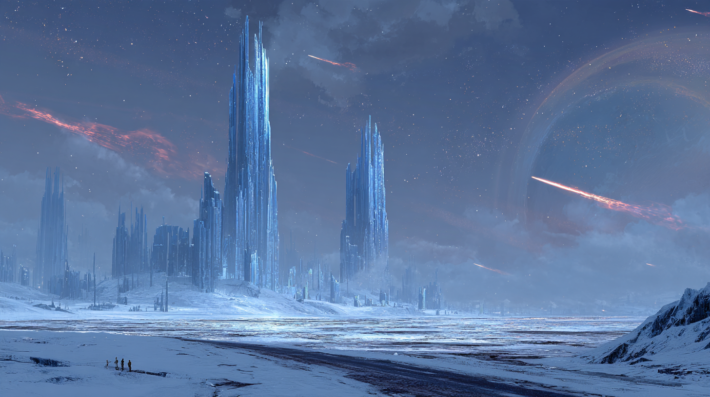

# Session 04 — Yedinci Kapı

**Yukarı:** [Oturumlar](README.md) · **Önceki:** [Session 03](session-03-silik-koy.md) ·
**Yay:** [Charaxis Yolu](../arcs/charaxis-yolu.md)

> 🎲 **Kısa DM notları.** Masada açık durur. `⬜` = senin slotun.

> ✏️ **Plan değişti (2026-10-29):** Charaxis'e **K-1 / Trell kâğıdı** ile değil,
> karşı kıyıdaki **Yedinci Kapı**'dan geçiliyor — Harper'ların yüz yıldır gizlice
> beklediği, 1385'te **mühürlenmiş** kapı. Duraklama gecesi **uyandı**; Stillreach'in
> dışına, **yolsuz buza** açılıyor. → [portal-network §7](../../../03-ager/planar-sites/portal-network.md#7-yedinci-kapı--mühürlü-olan)

---

## 0. Önceki bölümde *(30 saniye)*

- Silik köyde **Gallows Speaker**'ı öldürdünüz. Bozduğu **centaur**'u kurtardınız; sizinle gelmedi.
- **Halime** ve **Halit**'i buldunuz. Çıkarmak tehlikeliydi — **orada öldürdünüz.** Halime'nin elinde First Communion'ın **notu** vardı.
- **Vasili**, Speaker'ın elindeki **iğneyi** aldı.
- **Şimdi:** çıkış yolundasınız.

## Akış

| # | Sahne | Süre | Tür |
|---|---|---|---|
| 1 | [Kordon — Stane](#1-kordon--stane) | 20 dk | Sosyal |
| 2 | [Calithra — Vesna'ya rapor](#2-calithra--vesnaya-rapor) | 25 dk | Sosyal · **karar** |
| 3 | [Boğaz](#3-boğaz--karşı-kıyı) | 5 dk | Geçiş |
| 4 | ⚔️ [Yağmalanmış hücre](#4-encounter--yağmalanmış-hücre) | 40 dk | **Savaş** |
| 5 | [Yedinci Kapı — rünler ve geçiş](#5-yedinci-kapı--rünler-ve-geçiş) | 10 dk | Keşif |
| 6 | [Charaxis — ilk adım](#6-charaxis--ilk-adım) | 10 dk | **Tasvir** |
| 7 | ⚔️ [Donduran kuyu — elementaller](#7-encounter--donduran-kuyu) | 40 dk | **Savaş** |
| 8 | [Ufukta Stillreach](#8-bitiş--ufukta-stillreach) | 2 dk | Kapanış |

---

## 1. Kordon — Stane

**Nerede:** Grafting'in batı yamacı → Concord kordonu. Parti hangi yoldan çıkarsa çıksın
([S03 §4d](session-03-silik-koy.md#4d-çıkış)), kordon onları **görür.**

> ⏱️ **Zaman kaydı:** içeride zaman ×1d4 aktı. Dışarıda **⬜ gün** geçti *(öneri: 2 — bugün 23 Uktar)*.
> Stane'in randevusu **21 Uktar**'daydı.

**Açılış — iki küçük an:**
- 🧔 [Gruvv Ashani](../../../05-characters/npcs/minor/the-iron-concord/gruvv-ashani.md) Gwyndor'ı görür. Konuşmaz. Eli sakalındaki **bir düğüme** gider. *(Gwyndor saati dilim 2)*
- 🪖 [Rhoswen Marek](../../../05-characters/npcs/minor/the-iron-concord/rhoswen-marek.md) sayar: *"Beş girdiniz. Beş çıktınız. İçeride kalan başka kim var?"*

**[Marshal Stane](../factions-in-play/the-four-answers/the-iron-concord.md#marshal-vharra-stane) — komuta çadırı.** Çay, harita, kimse oturmuyor.

> *"Randevuya gelmedin. Ben de bekledim. Bir asker için bu ikisi aynı şeydir."*

### Stane ne soruyor — sırayla

| # | Soru | Neden soruyor | Cevaba göre |
|---|---|---|---|
| 1 | *"İçeride ne vardı?"* | Kordonu tutuyor; büyüme yönü | **Speaker öldü** derlerse: *"Büyüme durur mu?"* → **Hayır** *(Dikiş açık)*. Stane bunu not eder |
| 2 | *"Benim çavuşum ve iki askerim?"* | Resmen **inkâr ediyor**, özelde soruyor | Gördülerse ⬜ → Stane **borçlu** kalır. Görmedilerse: *"O zaman hâlâ içerideler."* |
| 3 | ⭐ *"Gökyüzü durdu. Sen de gördün. **Neredeydin?**"* | 🔒 Duraklama'yı **içinde** hissetti | Parti **Blink Dog**'u anlatırsa Stane'in yüzü bir an **değişir** — sonra toparlar |
| 4 | *"Shapeshifter'lar?"* | Kayıt tutuyor | Gwyndor'a Concord'un **kaydını** verir: kaç tanesi denedi, hangi yönden |

### Stane ne veriyor

| Ne | Ayrıntı |
|---|---|
| 🛡️ **Gwyndor'a bir yer** *(yumuşak)* | *"Ölmüş bir askerin bile bir yeri var. Kapı açık."* — teklif değil, **kapıyı aralamak** |
| ❄️ **Charaxis tohumu** | *"Karsovya'nın buzunda **üç bin beş yüz** Ravonyalı kazıyor. Bizim çocuklar. Kimse inip saymadı."* |
| ✉️ **Bir isim** | *"Stillreach'te ustabaşılar Ravonyalı. Oraya düşersen **benim adımı** söyle."* → Stillreach'te Ravonyalı işçiler Concord adına **kulak verir** |

### Dikkat — partinin ağzından kaçabilecekler

| Söylerlerse | Sonuç |
|---|---|
| **Harper'lar** | Concord Calithra'daki **Harper hücresini** öğrenir → [Brann](../../../05-characters/npcs/minor/the-iron-concord/aleth-brann.md)'ın kayıt masası onları arar. Vesna'nın en büyük korkusu |
| **Vasili'nin iğnesi** | Stane: *"Ledger'a yazılır."* İster |
| **Unwoven / silüet** | Stane **susar.** 🔒 Bir Chosen kendi kaynağının adını duymuştur |

> 🔒 **[DM ONLY]** Stane bir [Unwoven Chosen](../factions-in-play/the-four-answers/README.md#4-unwovenın-gerçek-planı--the-unweave)'ı.
> Duraklama gecesi rüyasında tek şey duydu: *"Biri bana dokundu."* Partiyi **o yüzden**
> bekledi. Onları **durdurmaz** — nereye gittiklerini bilmek ister.
> Gruvv'a fısıldar: *"Bunları izleyin."* *(Saat 6)*

**Çıkış:** Stane bırakır. Calithra girişinde [Brann'ın kayıt masası](../factions-in-play/the-four-answers/field-ops/iron-concord-teams.md#ic-1--kayıt-masası) — Gwyndor kaydolursa memur **ne yazacağını bilemez** *(saat dilim 1)*.

---

## 2. Calithra — Vesna'ya rapor

**Nerede:** [Merdiven Altı](../../../03-ager/continents/ravonia/regions/calithra/places.md#merdiven-altı--the-understair) — Standing Stone'un arkasındaki giriş.

> 🎬 *Vesna yayı dizine koymuş. Çalmıyor. "Oturun. Sırayla. Hiçbir şeyi güzelleştirmeyin."*

### Rapor — ne getirdiler, Vesna ne der

| Getirdikleri | Vesna |
|---|---|
| **Halime ve Halit'i öldürdük** | Uzun bir sessizlik. Tek bir uzun nota. *"Söylediğimi yaptınız. Bunu size söylemek zorunda kaldığım için kendimi affetmeyeceğim — sizi değil."* **Ceza yok.** Ödeme **tam** |
| 📜 **Halime'nin elindeki not** | Okur. Yüzü kireçleşir. *"Halime son nefesinde bunu tutuyordu. Bize getirmek için."* → **Ysolde Marr** — Silvaerûn'ün eski yüksek rahibesi; bir kapıda dokuz gün kayboldu, **ekibinin geri kalanı Charaxis'e düştü** → [Marr](../factions-in-play/the-four-answers/the-first-communion.md#ysolde-marr) |
| **Speaker öldü** | *"Kuzeyde gece artık erken bitmeyecek mi?"* → Hayır. Dikiş açık |
| **Centaur'u kurtardık** | Hafif bir gülümseme. Kayda geçmez |
| *(gördülerse)* Halime'nin **Si** notası | *"Si'yi ben öğrettim. 'Kaç' demek."* ⬜ |
| *(gördülerse)* Ölü shapeshifter / Concord çavuşu | [S03 §6](session-03-silik-koy.md#6-merdiven-altı--vesnanın-masası) tablosu |
| 🃏 Vasili | *"Shadowfell'e dokundun. Ne oldu?"* — merak ediyordu. İğneyi **sormaz**; ama **görürse** bakışı değişir |

> 💰 **Ödeme ⬜:** öneri **30 gp/kişi** + **2× Potion of Healing** *(PHB 2024)*.

> 🔒 **[DM ONLY]** Speaker önce öldüğü için Harper'lar çıkarılsa **yaşayacaklardı.**
> Vesna bunu **bilmiyor.** Bu sahnede **açılmaz.**

### ⭐ Dönüm — *neden Charaxis*

> *"Bir şey daha. Size söylemem gereken, yüz yıldır kimseye söylenmemiş bir şey."*

1. **Yedinci Kapı.** Ager'de resmen **altı** Charaxis kapısı var. 1385'te elfler bir **yedincisini** mühürledi ve Calith'in Harper'ları **1389'dan beri** onu bekliyor — boğazın karşı yakasında, Softsoil'in altındaki bir deniz mağarasında. *"Bu hücre bir şehri korumak için kurulmadı. Bir kapıyı **saklamak** için kuruldu."*
2. **Son mesaj.** Duraklama gecesi karşı yakadan bir fıçı geldi — halkası ters. İçinde tek satır: ***"Kapı uyandı. Öbür tarafta kar var."*** Sonra **üç gecedir** hiçbir şey.
3. **İstek.** *"Benim kimsem kalmadı. Ilva gitti, Halime ve Halit gitti. Siz varsınız."* Karşıya geçin, hücreye bakın. Kapı açıksa **geçin** — gökyüzünü durduran şeyi bulun. Bir rapor. Hepsi bu.
4. **Verdikleri:** **Harper işareti** *(hilal + arp, gümüş)* — *"kapının arkasındaki taşı bu açar"* · **geçiş şifresi:** *Vael'Toruun u thalas—shaen, khar.* · ödeme ⬜ *(öneri: dönüşte 100 gp/kişi)*

### Karar — her oyuncuya bir cümle

> Vesna'nın görevi herkese **aynı bileti** verir. Aşağıdakiler **kendi sebepleri** —
> masada **o oyuncuya** söyle. Ayrıntı: [Charaxis Yolu §4](../arcs/charaxis-yolu.md#4-kim-neden-gider--karakter-ipleri)

| PC | Cümle |
|---|---|
| **Gwyndor** | Stane'in *"üç bin beş yüz"*ü + Charaxis'in karanlık yüzünde **ölüler çürümez, bazen kalkar.** Onun gibi biri **orada** olabilir |
| **Grimnor** | Duraklama'da ailesini duydu. *"Kapıyı bir an açan şey **orada.** Bir daha yapmasın."* — Vesna: *"Charaxis'te rüyaları okuyan bir kadın varmış; eski bir Selûne rahibesi."* → [Miren Talvo](../../../05-characters/npcs/minor/miren-talvo.md) |
| **Vasili** | Altı saniye **yine kendisiydi.** O gücü geri verenin adresi bu kapının öbür tarafı |
| **Roger** | Cadının sesi geri geldi. Bariyeri delebilen şeyin cadıyı da getirip getirmeyeceğini bilmek ister. **Gemi onun** — karşıya o götürür |
| **Tek Kulak** *(varsa)* | Vesna'nın işareti açacağı **nişte ne var**? Bir hırsız için yeter |

> ⚠️ **Gitmezlerse:** zorlama. Ertesi sabah Nedra'nın fıçılarından biri daha gelir —
> **kanlı.** Hücre bitmiş. Bu, ikinci bir davettir.

**Opsiyonel (zaman varsa):** [S03 §7 Tek Kulak — sabah 4](session-03-silik-koy.md#7-tek-kulak--sabah-4) · [S03 §8 Hungry Gull](session-03-silik-koy.md#8-hungry-gull--crew) · [S03 §9 rüya](session-03-silik-koy.md#9-gece--rüya) *(rüya yola çıkmadan önceki gece çok iyi çalışır)*.

---

## 3. Boğaz — karşı kıyı

- ⚓ **[Hungry Gull](../../../05-characters/npcs/minor/the-hungry-gull/README.md)** ile [Lover's Cut](../../../03-ager/oceans-and-seas/lovers-cut.md). [Ione](../../../05-characters/npcs/minor/the-hungry-gull/ione-pell.md): *"İyi rüzgârla yarım gün."*
- Kuzeyde [Surfwale](../../../03-ager/continents/karsovia/sites/surfwale.md) kalesi; bayraklar okunuyor. Gemi kaleden uzak durur, güneydeki [Softsoil](../../../03-ager/continents/karsovia/villages/softsoil.md) koyuna yanaşır.
- 🎬 Koydan yukarı, kayalığın üstünde Harper hücresinin kapağı: bir **balıkçı kulübesi.** Kapısı açık, içi **dağıtılmış.** Masada yarım bir yemek. Aşağıda, mağaranın ağzında **ateş ışığı** ve sesler.
- **Crew:** gemide kalır — dönüş yolunun sigortası. ⬜ Roger isterse birini yanına alır *(öneri: [Pip](../../../05-characters/npcs/minor/the-hungry-gull/pip-fenn.md))*.

## 4. Encounter — yağmalanmış hücre

> 🎬 *Kulübenin zemininde bir kapak, altında kayaya oyulmuş merdiven. Aşağıda deniz
> mağarası. Dalga sesi — ve onun altında bir uğultu. Mağaranın dibinde, kayaya gömülü
> yarım daire biçiminde bir taş çerçeve **soluk beyaz** bir ışıkla nabız gibi atıyor.
> Önünde bir kamp: sandıklar, yanmış Harper kayıtları, şarap. On iki kişi. Bir köşede,
> bağlı, ağzı tıkalı biri.*

**Kim bunlar:** Duraklama gecesi mağaradan ışık sızdığını gören **kaçakçılar ve Surfwale
firarileri.** Hücreyi bastılar; iki Harper'ı öldürdüler, birini bağladılar. **Kayıtsız
bir Charaxis kapısı** onlar için bir servet: geçiş satacaklar. Kapıdan henüz geçmeye
cesaret edemediler — **geçen ilk ikisi dönmedi.**

| Kim | Statblock *(MM 2025)* | Sayı | XP |
|---|---|---|---:|
| **Rask Dorin** — eski Surfwale onbaşısı, elebaşı | **Bandit Captain** (CR 2) | 1 | 450 |
| Kaba adamlar | **Tough** (CR 1/2) | 2 | 200 |
| Haydutlar | **Bandit** (CR 1/8) | 6 | 150 |
| Okçular *(mağara çıkıntısında)* | **Scout** (CR 1/2) | 2 | 200 |
| 🧊 Kapıdan sızan | **Ice Mephit** (CR 1/2) — *aşağıda* | 0–1 | 0–100 |
| **Toplam** | | | **1.000–1.100** |

**Arena:**

| Öğe | Mekanik |
|---|---|
| 🪜 **Merdiven** | Tek kişilik, 30 ft — giriş darboğazı. Okçular buraya nişan alır |
| 🌊 **Gelgit** | Her **3 turda** su yükselir: alçak zemin Difficult Terrain, sonra **yüzme**. Kamp yüksek tarafta |
| 🧗 **Okçu çıkıntısı** | 15 ft yukarıda; Athletics DC 12 tırmanış ya da menzilli |
| 🌀 ⭐ **Kapının nabzı** | Her tur başında **d6**: **6** gelirse kapıdan bir **Ice Mephit** çıkar ve **en yakına** — kim olursa — saldırır. *(Charaxis'in ilk tadı)* Bir kez olur |

**Taktik:**
- Rask önce **pazarlık** dener: *"Kapı satılık. Size indirim."* Sonra **Leadership** ile adamlarını sürer.
- Haydutlar Bloodied olunca **kaçar** — merdivenden değil, **suya.**
- Rask kaybettiğini anlayınca **kapıya koşar.** Geçerse ⬜ — Charaxis'te onu yeniden görürler *(öneri)*.

**Esir:** **Maelis Toran** *(half-elf, Harper Watcher — Scout)*. Çözülünce:
- *"Kapı Duraklama'da uyandı. **Öbür tarafa bakıyor.** Kar var, ve **ses yok.**"*
- *"Arkasındaki taşı işaretle açarsın. Elfler bir şey bırakmış. **Onsuz geçmeyin.**"*
- *"Geçen iki haydut? Kapıdan **çığlıklarını** duyduk — bir adım öteden gelir gibi. Sonra hiçbir şey."*
- Maelis **geçmez** — hücreyi yeniden kurmak için kalır. Vesna'ya mektup yazar.

> 💰 **Ganimet:** Haydutların sandıkları: ~80 gp karışık sikke, yağmalanmış Harper malları *(Maelis geri ister)*, **1× Potion of Healing.**

---

## 5. Yedinci Kapı — rünler ve geçiş

**Niş.** Çerçevenin **arkasında**, kayada **hilal + arp** oyması. Vesna'nın işareti yerine
oturur, taş **açılır.** İçinde kararmış gümüş bir kutu: **[Nöbet Rünleri](../../../08-rules/homebrew/items/watch-runes.md)** — **altı taş.**

| | |
|---|---|
| **Ne yapar** | Tene basılır → rün yerleşir → **10 gün** *(yalnız Charaxis'te sayılır)* Black Still havasını soluyabilir, aşırı soğuğu yok sayar |
| **Rünsüz** | **Frozen Air:** her dakika sonu **DC 15 Con** ya da +1 Exhaustion |
| **Kaç tane** | 6 taş · parti 4 (+ Tek Kulak) → **bir taş artar** |
| **İpucu** | Kapakta elfçe: *Vael'Toruun.* Arcana DC 12: **Silvaerûn** işi, 1385 civarı |

> 🎬 **Rün sahnesi:** *Taş tenine değdiği an ufalanıyor. Bileğinden dirseğine soluk mavi bir
> çizgi uzanıyor — sanki derinin altından bir buz damarı geçiyor. Nefes veriyorsun. Nefesin
> buhar yapmıyor.*

**Geçiş:**
- Şifre: *Vael'Toruun u thalas—shaen, khar.* Çerçevenin ışığı **açılır.**
- 🎲 Kapı **sabitlenmemiş** → [d6 kararsızlık tablosu](../05-world-seeds.md#9-kararsız-portallar--charaxis-kapıları). *(Öneri: 2 gelirse sapma 1d10 mil — Stillreach'ten daha uzak düşerler.)*

> 🔒 **[DM ONLY]** Kapı neden uyandı: Duraklama'da bariyerle birlikte **sabitleme büyüleri** de
> bir an çözüldü; mühürlü kapı o an **nefes aldı** ve kapanamadı. [Saat 5](../06-clocks.md#-5-kapılar-bozuluyor)
> dilim 4'ün erken hâli: *"bir kapı kapanmıyor ve içinden bir şey geliyor."*

---

## 6. Charaxis — ilk adım

> 🎬 **Masada oku:**
>
> *Işık kapanıyor ve gece **bitmiyor.** Hiç bitmeyecek. Burada güneş hiç doğmadı.*
>
> *Siyah bir buz düzlüğünün üstündesiniz. Kirli değil — siyah; altındaki hiçbir şey ışığı
> geri vermiyor. Ayaklarınızın altında, buzun içinde, **yüzler** var. Bazıları çok eski,
> giysileri hiçbir çağa benzemiyor. Biri yakın — alnına yapışık küçük bir metal pul,
> üstünde bir vardiya numarası.*
>
> *Rüzgâr esiyor. Tenini kesecek kadar sert. Ama **ses çıkarmıyor.** Biriniz bir şey
> söylüyor ve kendi sesi ona **bir adım öteden** geliyor.*
>
> *Yukarıda yıldızlar — ve onları çizen kızıl kuyruklu yıldızlar. Ufkun alçağında devasa,
> soluk bir yüz: **Ager.** Evden bakınca Charaxis'i gördüğünüz gibi, şimdi o size bakıyor.*
>
> *Bileklerinizdeki rünler soluk mavi yanıyor. Nefes alıyorsunuz. Ve havanın ne kadar soğuk
> olduğunu **sadece** rünün titreyişinden anlıyorsunuz.*
>
> *Güneyde, çok uzakta, buzun üstünde mavi bir parıltı — kuleler gibi. Ve aranızdaki
> düzlükte, yarı yolda, hiçbir yıldızı yansıtmayan **kubbe biçimli bir şey.***

| Ne | Masada |
|---|---|
| 📍 **Nerede** | **Yolsuz buz**, [Black Still](../../../04-charaxis/regions/black-still.md). Stillreach (Don-64) **⬜ ~8 mil** güneyde — buzda **1 gün** yürüyüş |
| 🔇 **Ses** | Ses **bir adım öteden** gelir. Mekanik ceza yok — ama **gizlice konuşmak imkânsız:** fısıltı da bir adım öteden duyulur |
| ⏳ **Zaman** | Gündüz/gece yok. Charaxis **kol** ile sayar *(1 kol ≈ 6 saat)* → [vuruş](../../../04-charaxis/regions/meridian-road.md#vuruş--gezegenin-tek-saati) |
| 🧭 **Yön** | Stillreach'in mavi ışığı · Survival DC 12 |
| 🧊 **Kenarda** | İki haydudun cesedi — **rünsüz** geçmişlerdi. Donmuş, gözleri açık. Biri **nefesini tutarken** ölmüş |
| 🃏 **Vasili** *(özel not)* | Deste **ısınıyor.** Bir kart kıpırdıyor, dönmüyor. ⬜ |
| 🌕 **Grimnor** *(özel not)* | Charaxis'in elfçe adı **Shae'Khar** — Selûne. Ayı yok burada; **ay onlar.** |

---

## 7. Encounter — donduran kuyu

> 🎬 *Kubbe yaklaştıkça büyüyor: buzun içinden yükselen, kadim, pürüzsüz bir yapı — bir
> kuyu ağzı. Etrafında hava **titriyor.** Bir an aynı adımı iki kez attığınızı
> hissediyorsunuz. Sonra buzun altındaki yüzlerden biri **gözlerini açıyor** — ve buz
> **yukarı akmaya** başlıyor.*

[Donduran kuyu](../../../04-charaxis/regions/black-still.md#donduran-kuyular). Ham büyü burada yoğun;
**elementaller kendiliğinden doğuyor** — Duraklama'dan beri daha sık *([Saat 2](../06-clocks.md#-2-vahadaki-şey-yaklaşıyor) dilim 3'ün ilk işareti)*.

| Kim | Statblock *(MM 2025)* | Sayı | XP |
|---|---|---|---:|
| **Siyah Kar Fırtınası** — kuyunun soluğundan doğan bir girdap | **Air Elemental** (CR 5) — *görünüş: siyah kar; statlar aynen* | 1 | 1.800 |
| **Buz yüzleri** — buzdaki yüzlerden kopup çıkan küçük şeyler | **Ice Mephit** (CR 1/2) | 2 *(L3)* / 4 *(L4)* | 200 / 400 |
| **Toplam** | | | **2.000** (L3) · **2.200** (L4) |

**Kuyunun kuralları** *(200 ft yarıçap — [canon](../../../04-charaxis/regions/black-still.md#donduran-kuyular))*:

| Kural | Mekanik |
|---|---|
| 🔥 ⭐ **Ateş yanmaz** | **Fire damage çalışmaz — sihirli ateş dahil.** Arcana DC 15 bunu **savaştan önce** fark ettirir. *(Vasili'nin ateş büyüleri — önceden uyar)* |
| 🔁 **Çift an** | Her turun başında **d6**; **6** gelirse bir yaratık (DM seçer) bu turda **hareket edemez** — *aynı anı yeniden yaşıyor* |
| 🔩 **Metal ısınır** | Metal zırhlı karakter kuyunun 30 ft içinde tur sonunda **2 (1d4) Fire damage** — *ateş yanmaz ama metal ısınır; kimse sebebini bilmiyor* |

**Akış:**
1. **Tur 1:** Fırtına kuyudan **yükselir** — kar, ses yok, bir girdap.
2. **Tur 2:** Buzdaki yüzlerden **Ice Mephit**'ler kopar *(dalga hâlinde, ikişer)*.
3. Mephit'ler ölünce **soğuk patlaması** *(statblock)* — dar alanda toplanmayın.
4. Fırtına kuyudan **60 ft**'ten fazla uzaklaşmaz. Parti kuyudan uzaklaşırsa **peşlerine düşmez** → **kaçış bir seçenek.**

> 🔒 **[DM ONLY]** Fırtınanın içinde bir an — tek bir an — **bir insan silüeti** görünür.
> Kardan, yüzsüz. Partiye **bakmaya çalışır.** Sonra dağılır. Rüyadaki şey **burada da** var.
> Kimse ona saldırmadıysa, ölen fırtınanın yerinde buzda **beş parmak izi** kalır.

> 💰 **Ganimet:** Kuyunun dibinde buzun içinde donmuş bir madenci: **denge yükü** *(1 kol kalmış)*,
> **12 pul** *(Charaxis şirket parası)*, bir **vardiya pulu.**

## 8. Bitiş — ufukta Stillreach

*Oyunculara göster.*

> 🎬 *Buzun sonunda kuleler belirginleşiyor: yapılmamış, büyütülmüş gibi; çatlaksız, içeriden
> mavi yanan. Bacalardan duman çıkıyor ama yükselmiyor — havada asılı kalıp kuleler boyunca
> yana yayılıyor. Ve şehrin önünde, buza oyulmuş sıra sıra nişler. Her nişte biri var.*
>
> *Stillreach.*

**Session 05:** [Stillreach](../../../04-charaxis/regions/stillreach.md) — depo, Saatçiler, Soğuk İmtiyaz, Ravonyalı borçlular.

---

## 9. Denge — *XP bütçesi (DMG 2024)*

| Parti | Low | Moderate | High |
|---|---:|---:|---:|
| **5 × L3** | 750 | 1.125 | 2.000 |
| **5 × L4** | 1.250 | 2.500 | 3.750 |

| Encounter | XP | 5×L3 | 5×L4 | Knob |
|---|---:|---|---|---|
| **Yağmalanmış hücre** | 1.000–1.100 | Moderate | Low | L4: **+1 Bandit Captain** ve **+2 Tough** → 1.650 |
| **Donduran kuyu** | 2.000 / 2.200 | **High** | Moderate | Ateş yasağı + Exhaustion → L3'te zor. Gerekirse mephit **1** |

> ⚠️ **Gün sırası:** iki savaş **aynı gün değil** — aralarında kapı geçişi var. Geçişten önce
> **kısa dinlenme** mağarada mümkün. Charaxis'te uzun dinlenme **buzda** = rün olmadan ölüm;
> rünle mümkün ama **soğuk** (DM: dinlenme bölünür mü ⬜).
> ⚠️ **Ses kuralı:** verbal büyüler **çalışır** — ses bir adım öteden gelse de söylenmiştir.

## 10. Canlı notlar

| # | Ne | Not |
|---|---|---|
| 1 | ⬜ | |

## 11. Karşılaşmalar

| Sahne | Encounter | Sonuç |
|---|---|---|
| §4 | Rask Dorin + haydutlar | ⬜ |
| §7 | Siyah Kar Fırtınası + Ice Mephit'ler | ⬜ |

## Güncellenecek Dosyalar *(oynandıktan sonra)*

- [ ] `03-timeline.md` · 4× PC `03-development.md`
- [ ] Rünlerin kime verildiği → [watch-runes.md](../../../08-rules/homebrew/items/watch-runes.md)
- [ ] Maelis / Softsoil hücresinin durumu → [Calithra sırları](../../../03-ager/continents/ravonia/regions/calithra/05-secrets-dm-only.md)
- [ ] `00-meta/changelog.md`
