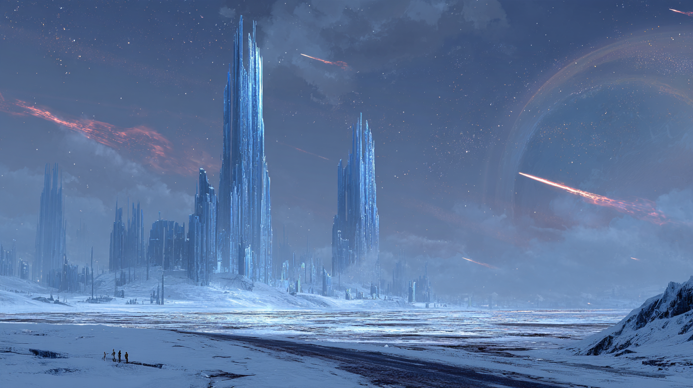

# Session 05 — Kapağın Altı

**Yukarı:** [Oturumlar](README.md) · **Önceki:** [Session 04](session-04-yedinci-kapi.md) ·
**Yay:** [Charaxis Yolu](../arcs/charaxis-yolu.md) ·
**Kim:** 🔒 [Calith](../../../05-characters/npcs/major/calith-auveran/README.md) ([statblock](../../../05-characters/npcs/major/calith-auveran/statblock.md) · [sırlar](../../../05-characters/npcs/major/calith-auveran/05-secrets-dm-only.md)) ·
**Şehir:** [Stillreach](../../../04-charaxis/regions/stillreach/README.md) ([mekânlar](../../../04-charaxis/regions/stillreach/places.md) · [kadro](../../../04-charaxis/regions/stillreach/people.md) · [görevler](../../../04-charaxis/regions/stillreach/quests.md))

> 🎲 **Kısa DM notları.** `⬜` = senin slotun. Portaldan geçtikleri an başlar.
> **Bu session'ın işi üç şey:** Calith ile tanışmak · kuyunun önünden geçmek · şehirde küçük işler ve alışveriş.

---

## 0. Önceki bölümde *(30 saniye)*

- **Stane**'e Calithra'daki **Harper**'ları anlattınız. Karşılığında bir **Defter** aldınız. Gwyndor taşıyor.
- **Vesna**'ya söylemeyin dendi. **Söylediniz.** Calithra'daki Harper işini durdurdu.
- Boğazda Concord **Vesna'ya ateş etti:** iki ok. Size kapıyı gösterdi, kendi insanlarını toplamaya gitti.
- Kapının önündeki haydutları öldürdünüz, bir gün **rünlere** attune oldunuz. **Şimdi:** soluk beyaz ışık. Şifreyi biliyorsunuz.

## Akış

```
              Kapı → ❄ Fig kuzeye yürüyor
                 ┌───────┴────────┐
          takip ediyorlar      etmiyorlar
                 ↓                │
        ⌂ Calith'in evi           │
                 └───────┬────────┘
                ◉ Donduran kuyu (Stealth)
                         ↓
           ▣ Stillreach: Bent · Sofra · işler · Emanet
                         ↓
     (evi görmedilerse: 🐈 Fig bir kapıyı tırmalar → ⌂ Calith)
                         ↓
                      📕 Bitiş
```

| # | Sahne | Süre | Tür |
|---|---|---|---|
| 1 | [Geçiş](#1-geçiş) | 5 dk | Geçiş |
| 2 | [Buz ve Fig](#2-charaxis--ilk-adım) | 10 dk | **Seçim** |
| 3 | ⭐ [Geç Kalan'ın Evi](#3-geç-kalanın-evi) | 40 dk | **Sosyal** |
| 4 | ⚔️ [Donduran kuyu](#4-encounter--donduran-kuyu) | 5–35 dk | Stealth → **savaş** |
| 5 | [Kuzey Bent, Kapak altı](#5-kuzey-bent-ve-kapak-altı) | 15 dk | Tasvir |
| 6 | [Kazan Sofrası](#6-kazan-sofrası--grimgor-ve-orklar) | 20 dk | Sosyal |
| 7 | 💰 [Küçük işler](#7-küçük-işler) | 30–45 dk | XP + altın |
| 8 | 🛒 [Emanet Hanesi](#8-emanet-hanesi--dükkân) | 15 dk | Alışveriş |
| 9 | [Bitiş](#9-bitiş) | 5 dk | Kapanış |

> ⏳ **Zaman azsa:** §7'de **bir** iş, §6 sadece soğan. **§3 kesilmez.**

---

## 1. Geçiş

- Şifre: *Vael'Toruun u thalas—shaen, khar.* Işık **açılır.**
- 🎲 [d6](../05-world-seeds.md#masada--geçiş-başına-d6): 1 bir gün bekle · 2 sapma *(1d10 mil öneri)* · 3 herkes +1 Exhaustion · 4 bir şey daha geçti · 5 kapı kapanmadı · 6 temiz.
- 📕 Defter'in mürekkebi bir an **donar**, sonra akar. Çalışıyor.
- ⏳ **Rün sayacı başlar: 10 gün** *(1 Ager günü = 4 kol).*
- 🧟 Rahadin ve Gwyndor nefes almıyor: Frozen Air işlemez.

## 2. Charaxis — ilk adım

> 🎬 **Masada oku:**
>
> *Işık kapanıyor ve gece bitmiyor. Siyah bir buz düzlüğünün üstündesiniz. Ayaklarınızın altında, buzun içinde, **yüzler** var.*
>
> *Rüzgâr tenini kesecek kadar sert, ama **ses çıkarmıyor.** Biriniz bir şey söylüyor ve kendi sesi ona **bir adım öteden** geliyor. Ufkun alçağında devasa, soluk bir yüz: **Ager.***
>
> *Güneyde, çok uzakta, mavi bir parıltı: kuleler. Kuzeyde hiçbir şey. Yıldızlar bile daha az.*
>
> *Ve kuzeye doğru, buzun üstünde, sizden yirmi adım önde, kırmızımsı bir tekir **yürüyor.***
>
> *Acele etmiyor. Üşümüyor. Kuyruğu dik. Durup omzunun üstünden bakıyor. **Grimgor'a.** Sonra yürümeye devam ediyor.*

| Ne | Masada |
|---|---|
| 🐈 **[Fig](../../../05-characters/npcs/minor/fig.md)** | Calithra'nın kedisi. Sol kulağında çentik, boynunda arp halkası. *Rün yok.* Karda iz bırakmıyor |
| 🧭 **Yön** | Kuzey = daha soğuk, şehrin **tersi.** Güney = mavi ışık, Survival DC 12 |
| 🔇 **Ses** | Bir adım öteden. **Fısıltı imkânsız** |
| ✨ **Ham büyü** | Slotlu her büyüde d20: **1–2 → Wild Magic Surge** ([kural](../../../04-charaxis/phenomena/README.md#3-ham-büyü--masa-kuralı)). ⚠️ *Battle Familiar* dâhil: **Erdem'e söyle** |
| 🧊 **Kenarda** | İki haydudun cesedi: **rünsüz** geçmişlerdi. Donmuş, gözleri açık |
| 🌕 **Grimgor** | Charaxis'in elfçe adı *Shae'Khar.* *Ayın üstündesin.* Sembol ısınıyor |

**Seçim masaya:**

| | |
|---|---|
| 🐈 **Takip ederlerse** | Bir saat kuzeye → [§3](#3-geç-kalanın-evi). Fig çok uzaklaşırsa bekler |
| 🏙️ **Etmezlerse** | Fig bir daha bakar, gözden kaybolur. → [§4](#4-encounter--donduran-kuyu). **Sonra [şehirde](#fig-kapıyı-tırmalıyor) geri gelir** |
| ⚔️ **Yakalamaya çalışırlarsa** | Yakalanmaz. Grimgor'a *değil,* elini uzatana bakıp yürür |

---

## 3. Geç Kalan'ın Evi

> 🎬 *Bir saat. Ufuk değişmiyor; bir an önce olmayan bir şey orada: alçak, yuvarlak, taş bir kulübe. Bacadan **ince, düz** bir duman. Kapının önünde bir tabure.*
>
> *Fig eşiğe oturup size bakıyor. İçeriden bir şey geliyor: o kadar alçak ki önce **ses** olduğunu anlamıyorsunuz. Bir arp.*
>
> *Kapıyı açıyorsunuz ve biri bir şey diyor; **sesi kendi ağzından** geliyor. Ocak yanıyor. Saksıda bir asma. Dört uyumsuz sandalye. Ayakta, kırçıl sakallı, yalınayak, küçük bir adam, başını kaldırmadan çalıyor:*
>
> *"Oturun. Beş kişisiniz, dört sandalye var. Bu evde hep biri ayakta kaldı."*

**Kim:** [Calith Auveran](../../../05-characters/npcs/major/calith-auveran/README.md), *Geç Kalan.* **[Yer kuralları](../../../04-charaxis/regions/latecomers-house.md#kurallar):** ses normal · rün sayacı durur · surge yok · bir kez uzun dinlenme.

> **Oynama anahtarı:** Çok sıcak, çok neşeli, **elleri hiç durmuyor.** Kendisi **soru sormaz:** ne öğrenmek istiyorlarsa sormak zorundalar. Sordukları her şeye **doğru** cevap verir.

### 📕 Eşikte Defter

Fig Gwyndor'ın çantasına bakar, **eşikten çekilmez.** *"Onu dışarı bırakın. Çalınmaz; kim çalacak?"*
Bırakmazlarsa: *"Peki. O zaman bu evde adımı söylemeyin."* → 🔒 [Defter ve ad](../../../05-characters/npcs/major/calith-auveran/05-secrets-dm-only.md#defter-ve-ad)

### Soru → cevap

| Parti sorar | Calith |
|---|---|
| *"Sen kimsin?"* | *"Bir şehri bıraktım, adını yerden aldılar. Beni Geç Kalan diye çağırın."* Fig'in halkasını gösterir: *yalnız arp* |
| ⭐ ***"Vesna bizi neden gönderdi?"*** | *"Size rapor istediğini söyledi. **Rapor benim.** Halkayı ben taktım. Bir haftadır biliyordu. Söyleseydi birinin defterine yazılırdı. Haklıymış."* |
| *"Gökyüzünü kim durdurdu?"* | *"Vahadaki şey. Kardan bir şekil. Sizi fark etti. Dört kişi aynı anda dört ayrı şey istediniz; bunu daha önce görmemişti."* |
| *"Neden burada çalıyorsun?"* | *"Dinliyor. Çaldıkça yavaş geliyor."* Parmak uçlarına bakın: **kan** |
| *"Bizimle gel."* | *"Bir mil. O kadar. Durursam bütün gezegen duyar."* |
| *"Selûne?"* | *"Onu tanırım. Dua ettim demiyorum; **tanırım.** Sesini bilirim. Bir kez güldü. Bu dünyanın üstünde oturuyorum ve 1494'ten beri **ona ulaşamıyorum.** Adıyla çağırırsam duvara çarpar. Adsız çağırırsam kime gittiğini bilemem."* |
| *"Vaha'ya nasıl gidilir?"* | *"Gidilmez. Biri döndü: [Sorka](../../../05-characters/npcs/minor/sorka-ucdis.md). Ona kimse sormadı. Kurtlarına sorun."* |

### ⭐ Grimgor — *kim yaptı*

> **Koray'ın anı.** Fig kucağına oturur, kalkmaz. Calith **söylemez.** Koray sorana kadar bekle. Sorarsa **merdiven:** [sırlar §Grimgor](../../../05-characters/npcs/major/calith-auveran/05-secrets-dm-only.md#grimgor--kim-yaptı).

| Soru | Cevap |
|---|---|
| *"Ailemi kim öldürdü?"* | *"Köy. Sonra sordun, kim kurdu? **Malar.** Beastlord."* |
| *"Selûne gördü mü?"* | *"Gördü. O gece gökyüzündeydi. Bana söyledi; son söylediklerinden biriydi."* |
| *"Neden gelmedi?"* | *"Onu söylemedi. Geç kaldı mı, gelmedi mi, bilmiyorum. Geç kalmayı bilirim. İkisi uzaktan aynı görünür."* |
| *"Ailem nerede?"* | *"Gitmediler. Hat koptu. **Bekliyorlar.** Duraklama'da duyduğun oydu."* |

> ⚠️ Sonra sessizlik. Koray'a *ne yapıyorsun* diye sor, başka kimseye değil. Saksıdaki asma **toprak kokuyor;** *ne yapacağını bilemiyorsa ona dokunsun.*

### Ötekiler

| PC | An |
|---|---|
| 🛡️ **Gwyndor** | *"Çürümüyorsun. Ben de. Ben durdum. Sen başka bir şey oldun; bir gün birine sorarsın."* Defter'i sorarsa: *"Onu kimin verdiğini biliyorsun. Neyi **gördüğünü** sor."* |
| 🧟 **Vasili** | Rahadin içeri girer, **sandalye çeker.** Calith gülmekten bir an tellerini kaçırıyor gibi olur; kaçırmaz. *"Uşağının adı güzel. Kimin adı olduğunu sormayacağım."* ⬜ Vasili sorarsa: *"Geri alınır mı?"* → *"Altı saniye aldın. Bedelini henüz sormadılar."* |
| ⚓ **Roger** | *"Kurye. Paketlerin ne olduğunu sormadın. Bu kural bana ait; sana iyi gelmedi."* Moondust kokusunu alır. *"Fig yine de seni içeri aldı."* |
| 🗡️ **Tek Kulak** | Calith ona hiç bakmaz, **sonra** bakar: *"Sen rüya görmüyorsun. Çok iyi. Onun göremediği iki kişi var bu odada."* |

### ⭐ Tökezleme — *"Vesna nasıl?"*

Calith Harper'ları sordurmaz; **Fig oradaydı,** biliyor: *"Sattınız, sonra da gidip söylediniz. İkincisini kimse yapmazdı."*

Ama **okları bilmiyor.** Biri söylediği an:

> 🎬 *Şarkı **bir nota tökezliyor.** Hiç duymadığınız bir şey duyuyorsunuz: sessizlik. Yarım saniye. Çok uzakta, kuzeyde, bir şey **kımıldıyor** ve ayağınızın altındaki buz dinliyor. Sonra arp yine.*
>
> *"...Kaçı öldürür iki ok, yaşlı bir kadını?"*

İlk sorusu bu. Fig kulaklarını indirir. → [Saat 2](../06-clocks.md#-2-vahadaki-şey-yaklaşıyor) ⬜ +1.

### Çıkış — *verdikleri*

| Ne | Mekanik |
|---|---|
| 🛏️ **Bir uzun dinlenme** | Rün sayacı işlemez |
| 🎵 **Şarkının sonundan bir ölçü** | Herkese **Heroic Inspiration** |
| 🤫 **Kuyu tavsiyesi** | *"Kuyu sesi duymaz, **sıcaklığı** duyar. Rünü kolun içine çevir. Metali sarın."* → [§4](#4-encounter--donduran-kuyu) grup Stealth'e **Advantage** |
| ✉️ **İstek** | *"Vesna'ya **La** deyin. Bilir."* · *"Bir daha gelmek isterseniz Fig'i bulun; kapıyı o tırmalar."* |

> 🔒 **[DM ONLY]** Asıl istediği silüete *"hayır"* diyecek biri → [Ninni](../../../05-characters/npcs/major/calith-auveran/05-secrets-dm-only.md#ninni). **Söylemez.** Fig'in Grimgor'a oturması yeter.
> 💰 **XP:** Calith'i bulmak **200 XP/kişi.**

---

## 4. Encounter — donduran kuyu

**Her iki yol da buradan geçer:** Buz sırtları güneye giden her yolu kuyunun kenarına indirir.

> 🎬 *Düzlükte hiçbir yıldızı yansıtmayan, **kubbe biçimli** bir şey. Etrafında hava titriyor. Bir an aynı adımı iki kez attığınızı hissediyorsunuz. Buz siyah, ve buradaki yüzler **size bakıyor.***

### Önce Stealth

**Grup Dexterity (Stealth) DC 14:** yarısı geçerse grup geçer.

| Etki | |
|---|---|
| 🎵 Calith'in tavsiyesi | Herkese **Advantage** |
| 🛡️ Metal zırh | Stealth Disadvantage *(zırhı kuralı)*: Gwyndor |
| 🧟 Rahadin | Ayağını sürüyor. Erdem onu *pocket dimension*'a gönderirse sorun yok; göndermezse **grubun sonucuna −2** |
| 💡 Işık | Fener/*Light* varsa **−2.** Ateş zaten yanmıyor |

| Sonuç | Ne olur |
|---|---|
| ✅ **Geçti** | Kuyu arkalarında kalır. Sadece omuzdan bakanlar görür: buz **yukarı akıyor,** sonra duruyor. **220 XP/kişi** |
| ❌ **Kaldı** | ↓ Savaş |

### Savaş

> 🎬 *Buzun altındaki yüzlerden biri **gözlerini açıyor.** Buz yukarı akmaya başlıyor. Kuyudan siyah kar yükseliyor: ses çıkarmadan.*

| Kim | Statblock *(MM 2025)* | Sayı | XP |
|---|---|---|---:|
| **Siyah Kar Fırtınası** | **Air Elemental** (CR 5): *görünüş siyah kar, statlar aynen* | 1 | 1.800 |
| **Buz yüzleri** | **Ice Mephit** (CR 1/2) | 4 *(tur 2'de 2, tur 4'te 2)* | 400 |
| **Toplam** | | | **2.200 — Moderate** |

| Kuyunun kuralı | Mekanik |
|---|---|
| 🔥 **Ateş yanmaz** | **Fire damage çalışmaz, sihirli ateş dahil.** Arcana DC 15 savaştan önce fark ettirir |
| 🔁 **Çift an** | Her tur başı **d6; 6** → bir yaratık (DM) bu tur **hareket edemez** |
| 🔩 **Metal ısınır** | Metal zırhlı, kuyunun 30 ft içinde tur sonunda **2 (1d4) Fire damage** ⚠️ Gwyndor |
| 💥 **Mephit ölünce** | Soğuk patlaması: dar alanda toplanmayın |
| 🏃 **Kaçış** | Fırtına kuyudan **60 ft**'ten uzağa gelmez |

> 🧟 Rahadin ilk kez savaşıyor: Vasili'nin *"Rahadin. Lütfen."* cümlesini masada duyalım.
> 💰 **Ganimet:** Kuyunun dibinde donmuş madenci: **denge yükü** *(1 kol)*, **12 pul**, **vardiya pulu** *("Stillreach — Don-64 — 3. Bölük")* → [iş 5](#7-küçük-işler).
> 🔒 **[DM ONLY]** Fırtınanın içinde bir an kardan yüzsüz bir **silüet.** Grimgor'a bakmaya çalışır. Sonra dağılır. Fırtına ölürse → [Kör Patlak](../../../04-charaxis/regions/stillreach/set-pieces.md#kör-patlak) sonraki session'a hazır.

**Yürüyüş:** Kuyudan şehre ~1 kol. **Kısa dinlenme** yapılır.

---

## 5. Kuzey Bent ve Kapak altı


*Oyunculara göster.*

> 🎬 *Buzdan bir sed, üstünde üç fener. Bir ses, çok sıkılmış: "...Kuzeyden mi geliyorsunuz?"*

**[Çavuş Tolga Erden](../../../04-charaxis/regions/stillreach/people.md#tolga-erden)** + 6 Guard. Defteri açar, kalemi yalar. *"Kuzeyde yol yoktur. Yazacak yer bulamıyorum."*

| Yol | Sonuç |
|---|---|
| 💰 Rüşvet | **5 gp/kişi.** Geçici pul |
| 🗣️ Yalan | Persuasion/Deception DC 13 *(rün görünürse DC 16)* |
| 🪪 Vardiya pulu | Kuyudan çıktıysa: *"sefer artığıyız"* DC 10 |
| 🐺 [Sorka](../../../05-characters/npcs/minor/sorka-ucdis.md) | Kızak Ağzı'nda bakıyor: *"Benim artıklarım."* Bedeli sonra |

> 🎬 *Kızak Ağzı'ndan geçtiğiniz an kuleler kayboluyor. Elli fit yukarıda gökyüzü bitiyor. Tavan ıslak yün gibi siyah. Ağzınızda is, dişinizin arasında buz tozu. Otuz adım ötesi gri. Zincir, kızak demiri, öksürük. Bir ork, sırtında kendisi kadar buz bloğu, size bakmadan geçiyor. Biri duruyor, **Grimgor'a** bakıyor.*
>
> *"Kimin orkusun?"*

**Masa kartı:** 🌫️ 30 ft net, 100 ft ötesi yok · 😮‍💨 maskesiz uzun dinlenme DC 10 Con *(maske 2 pul)* · 🏃 kimse koşmaz. → [kurallar](../../../04-charaxis/regions/stillreach/README.md#masa-kuralları--kapak-altı)
**Kalacak yer:** [Kazan Sırası](../../../04-charaxis/regions/stillreach/places.md#kazan-sırası) barakası *(2 pul/kişi)* · Kumpanya Hanı *(1 gp, bir soru)*.

**Şehir yaşıyor — d6, sahne geçişinde:**

| d6 | |
|---|---|
| 1 | Vardiya çanı. Sokak doluyor; kimse koşmuyor. Bir dakika sonra boş |
| 2 | Kurt sürüsü, tek ork önde. **Kurtlar insanların arasından** kimseye değmeden geçiyor |
| 3 | İki Demirdiş vinç tamir ediyor. Gharuk ateşçisi orkça tükürüp geçiyor. Kimse başını kaldırmıyor |
| 4 | Saatçi çırağı: *"Son kolunuz ne kadar sürdü?"* Yazar. *"Teşekkürler."* |
| 5 | Kışla tahtası: *"Bu ay 0 isyan."* Bir Ravonyalı yüksek sesle okur: *"Sıfır."* Asker gülmez |
| 6 | Ova Şarkısı, kazandan kazana. Toprağı anlatıyor. **Söyleyenlerin yarısı toprak görmedi** |

---

## 6. Kazan Sofrası — Grimgor ve orklar

> **Burada kimse Grimgor'ı dövmeye çalışmaz. Hepsi sorar.** Soruyu **Koray'a doğrudan** sor.

**Tetik:** İkinci *"Kimin orkusun?"*. Biri: *"Sofraya gel. Soran çok olacak, bari sıcakta sorsunlar."*

> 🎬 *Kazanın sıcak duvarına yaslı uzun bir masa. Bir ucunda yağlı eller, öbür ucunda yeşil bez, köşede kurt kokanlar. **Ortada kimsenin oturmadığı bir boşluk.** Fener altında, kırık saksıda, **bir soğan.***

| Kim | Soru | Batan yer |
|---|---|---|
| ⚙️ [Bralga](../../../05-characters/npcs/minor/bralga-ormak.md) *(Demirdiş)* | *"İnsan köyünde büyümüşsün. Sana ne dediler?"* | *"Biz cücelerin içinde çözdük. Sen ne yaptın? Köyün nerede?"* |
| 💰 [Urzha](../../../05-characters/npcs/minor/urzha-keth.md) *(Gharuk)* | *"Defterin yok, borcun yok. **O zaman neden yaşıyorsun?**"* | Moondust'a sıkıştırırsa: *"Ekmeği kim alıyor? Sen ne koyuyorsun?"* |
| 🐺 [Sorka](../../../05-characters/npcs/minor/sorka-ucdis.md) *(Kırık Boynuz)* | *"Hangi tanrı seni bıraktı?"* | *Calith'ten sonra:* bu soruya ilk kez **cevabı** var |
| 📜 [Ulgar](../../../04-charaxis/regions/stillreach/people.md#ulgar-harfçi) *(Ataman)* | *"Adını yaz. Ork ulusu kurulsa nerede durursun?"* | *"Devletsiz ork. Ataman'a götüreceğim. Bu iyi bir şey değil."* |
| ⭐ Yaşlı bir ateşçi | *"Savaşta hangi taraftaydın?"* → *"Savaşa girmem."* | *"Yani **seyrettin.**"* Seyirci suçludur diyen adama. Sessizlik |

### ⭐ Soğan

*"Çiftçiydim"* derse masa güler. Sonra [Tuk](../../../04-charaxis/regions/stillreach/people.md#tuk) saksıyı önüne iter: *"Toprak nasıl kokuyor?"* Herkes dinliyor. *Druidcraft* ya da bir tutam toprak: **soğan filizlenir, üç defterin üç ucu aynı anda susar.** Check yok.

### Moon druid anları

> İkisini kullan.

| Ne | Masada |
|---|---|
| 🌑 **Ay nerede?** | Kapak altında ne ay ne yıldız. *Yukarıda değil: ayağının altında.* Yere dokununca **sembol ısınır** |
| 🐀 **Toz sıçanı** | *Speak with Animals* çalışır. d4: *"Kapak'ın üstünde yemek var, çıkan dönmüyor."* · *"Depo'da biri tırmalıyor. Yemek tırmalamaz."* · *"Kurtlar sana yatıyor. Biz senden kaçmalı mıyız?"* · *"Gri odadakiler uyuyunca aynı şeyi söylüyor."* |
| 🐺 **[Kurt Ahırı](../../../04-charaxis/regions/stillreach/places.md#kurt-ahırı)** | Otuz kurt başını kaldırır, biri karnını gösterir. Sürü düzeni. [Damga](../../../04-charaxis/regions/stillreach/05-secrets-dm-only.md#maların-damgası--kurt-ahırı). *Malar'ı duyduysa bu sahne başka okunur* |
| 🐾 **Wild Shape** | Kurt dikkat çekmez. Ayı çeker: çocuklar peşinden yürür. Rün de dönüşür, kürkün altında mavi damar |
| 🌘 **[Ay Çukuru](../../../04-charaxis/regions/stillreach/places.md#ay-çukuru)** | Selûne'e dua ediyorlar, duymuyor, biliyorlar. Davasını burada söyleyebilir mi? ⬜ |

### Fig kapıyı tırmalıyor

> **Evi görmedilerse. Tam burada ya da [§7](#7-küçük-işler) sonunda.**

> 🎬 *Kırk ateşçinin arasından, hiç kimseye değmeden, kırmızımsı bir tekir geliyor. Grimgor'un dizine çıkıyor, bir an duruyor, iniyor. Sofranın arkasındaki kömür kapısına gidiyor ve **tırmalıyor.** O kapı duvara açılır; herkes bilir.*
>
> *Kapının altından **ılık bir hava** geliyor. Ve bir arp.*

Calithra'da duydular: ***"Kedi neredeyse orası."*** Kapı → [§3](#3-geç-kalanın-evi). Bitince aynı kapıdan Sofra'ya dönerler; Sofra'da **bir tas çorba hâlâ sıcak.** *(Kuyu tavsiyesi boşa gider; XP yine verilir.)*

---

## 7. Küçük işler

> Kömürle duvara yazılmış, her işin bir alacaklısı var. **Tercihen 2 tane.** Oynanmayan **sonraki session'a kalır.** XP toplamı partiye bölünür. Altın **toplam.**

| # | İş | Veren | Ne | XP | 💰 |
|---|---|---|---:|---:|---:|
| 1 | [Pas Kokusu](../../../04-charaxis/regions/stillreach/quests.md#pas-kokusu) | [Bralga](../../../05-characters/npcs/minor/bralga-ormak.md) | Galeri rayını yiyenleri temizle: 4 **Rust Monster** + 1 **Ochre Jelly** | 850 | 120 gp |
| 2 | [Kayıp Kurt](../../../04-charaxis/regions/stillreach/quests.md#kayıp-kurt) | [Sorka](../../../05-characters/npcs/minor/sorka-ucdis.md) | Bent ötesinden kurdu getir: **Winter Wolf** + 2 **Ice Mephit** | 900 | 90 gp |
| 3 | [Kör Kol](../../../04-charaxis/regions/stillreach/quests.md#kör-kol) | [Halla](../../../04-charaxis/regions/stillreach/people.md#halla-venn) | Gaz dolan galeriden üç kişi: skill challenge | 600 | 60 gp |
| 4 | [Soğuk Tahsilat](../../../04-charaxis/regions/stillreach/quests.md#soğuk-tahsilat) | [Urzha](../../../05-characters/npcs/minor/urzha-keth.md) | Borçlu kapıya barikat kurdu: 91 gp'yi al. Tuk'un kardeşi ⬜ | 400 | 100 gp *(ya da 0)* |
| 5 | [Son Pul](../../../04-charaxis/regions/stillreach/quests.md#son-pul) | Kuyudaki madenci | Vardiya pulunu dul eşe götür | 150 | 15 gp + *Potion of Healing* |

> Roger için: [Geçen Yılın Paketi](../../../04-charaxis/regions/stillreach/quests.md#8-geçen-yılın-paketi). Tek Kulak için: [Sayılmayan Saat](../../../04-charaxis/regions/stillreach/quests.md#7-sayılmayan-saat). Büyük işler: [Dördüncü Vaka](../../../04-charaxis/regions/stillreach/quests.md#1-dördüncü-vaka) · [Kuzey Seferi](../../../04-charaxis/regions/stillreach/quests.md#6-kuzey-seferi).

---

## 8. Emanet Hanesi — dükkân

> 🎬 *İki zırh kapıda duruyor, biri başını size çeviriyor. İçeride yüzlerce raf; her eşyanın ipinde bir kâğıt: **bir ad ve bir borç.** Masada ufak bir cüce kadın, gözünde mercek: "Ölü malı, kaçan malı, rehin malı. Hepsi çalışır. Kim ödediyse ona teşekkür etmeyin."*

**[Dorna Kelk](../../../04-charaxis/regions/stillreach/people.md#dorna-kelk).** **Tam stok ve fiyatlar:** [Emanet Hanesi](../../../04-charaxis/regions/stillreach/places.md#emanet-hanesi). Fiyatlar pazar *(DMG 2024)*; **satışta yarı fiyat alır.** Pazarlık yok; Persuasion DC 15 → %10.

**Bu masaya en çok yarayanlar:**

| Kime | Ne | Fiyat |
|---|---|---:|
| Herkes | *Potion of Healing* · *(Greater)* | 50 · 200 |
| 🧟 Vasili | **Elmas** *(Battle Familiar)* · *Pearl of Power* | 25 · 400 |
| 🛡️ Gwyndor | *Shield, +1* · *Armor of Resistance (Cold)* | 410 · 4.075 |
| 🌕 Grimgor | *Ring of Warmth* · *Boots of the Winterlands* | 400 · 400 |
| ⚓ Roger | *Cloak of Protection* · *Bracers of Defense* | 400 · 4.000 |
| 🗡️ Tek Kulak | *Cloak of Elvenkind* · *Dagger, +1* | 400 · 402 |
| 📕 Defter sahibi | *Amulet of Proof against Detection and Location* | 400 |

> **Dorna ve Defter:** Gösterirlerse merceği bırakır: *"Değer biçemediğim ilk şey. Satılık mı? — Hayır, alma diyorum. Sadece sordum."*
> **Dorna ve Rahadin:** *"Bu satılık mı?"* 🧟 Vasili: *"Sorduğunu duymadı. Sen de sormadın."*

---

## Defter — *masada canlı*

> 📕 **Gwyndor ne zaman baksa** yeni satır **araya** girmiş olabilir. Fark etmek DC 15 · Ad aramak 10 dk, DC 12.

| # | Ne zaman | Satır | Anlamı |
|---|---|---|---|
| 1 | Bent'ten sonra | *Maelis Toran — half-elf — Softsoil — Harper (Watcher)* ⬜ | Parti konuştu, **Concord yürüdü** |
| 2 | İlk kol | *Tuk — ork — ateşçi — borç 91 gp — **niş: —*** | Biri **şehirde** yazıyor. Neden *niş* sütunu? → [Yazan El](../../../04-charaxis/regions/stillreach/quests.md#2-yazan-el) |
| 3 | Sofra'dan sonra | Adını söylediği biri | Aynı el |
| 4 | ⬜ Gwyndor'ı ararsa | *Gwyndor — Ravonya Kraliyet Ordusu — **tür: —** — **durum: görüldü*** | [Kişisel saat](../../../05-characters/player-characters/new-campaign/gwyndor/03-development.md#4-kişisel-saat--defterdeki-i̇sim) |
| 5 | ⚠️ **Calith'i ararsa** | **Yok.** Hiçbir sayfada. Sahibi: *adsız* | Parti ilk kez defterin **göremediği** birini bildi. **Yazılmasın** |
| 6 | ⭐ **§9** | *Vesna Marroc — insan — kemancı — **iki ok yarası** — yer: ⬜* | Bulundu mu, sayıldı mı? |

---

## 9. Bitiş

Vardiya çanı. Parti barakada, kazanın duvarı sıcak. Üç şey, sırayla:

1. **Fig** Grimgor'un dizinde. Kuzeye bakıyor. Hep aynı yöne.
2. **Defter** Gwyndor'ın çantasında ağır. Sayfa kendi kendine açık. → **Vesna'nın satırı.**
3. Çok uzakta, duymanız gerekmeyen bir yerde, **bir arp.** *Yere kulağını dayayan bir orkun yüzü değişiyor.*

**Son soru masaya:** *Vesna'ya La'yı nasıl götüreceksiniz?* *(Evi görmedilerse: Fig'in kapısı açık.)*

---

## 10. Denge — *XP (DMG 2024)*

| Parti | Low | Moderate | High |
|---|---:|---:|---:|
| **4 × L4 + 1 × L5** | 1.500 | 2.250 | 3.100 |
| **4 × L4** *(Ozan yoksa)* | 1.000 | 1.500 | 2.000 |

| Ne | XP | Not |
|---|---:|---|
| **Donduran kuyu** | 2.200 *(Moderate; 4 kişide High+)* | 4 kişide 2 mephit → 2.000 |
| Stealth ile geçiş | 1.100 | 220/kişi |
| Calith'i bulmak | 1.000 | 200/kişi |
| İş 1 / 2 | 850 / 900 | **Low** altı; parti dinlenmiş |
| İş 3 / 4 / 5 | 600 / 400 / 150 | Check |

> ⚠️ L4→L5 kişi başı 3.800 XP ister. Hepsi yapılırsa ~1.200/kişi. **Bu session seviye atlatmaz.**
> ✏️ [S04 §9](session-04-yedinci-kapi.md#9-denge--xp-bütçesi-dmg-2024)'daki *5×L4* satırı hatalıydı; doğrusu 1.250 / 1.875 / 2.500.

## 11. Saatler *(öneri ⬜)*

| Saat | Dilim | Neden |
|---|---|---|
| [Saat 2 — Vahadaki Şey](../06-clocks.md#-2-vahadaki-şey-yaklaşıyor) | +1 | **Tökezleme.** Calith'in şarkısı durdu |
| [Saat 5 — Kapılar](../06-clocks.md#-5-kapılar-bozuluyor) | d6'ya göre | Yedinci Kapı kapanmıyor |
| [Saat 6 — Dört Cevap](../06-clocks.md#-6-dört-cevap) | +1 | Concord Harper'ları avlıyor |
| **Grimgor** | +1 | *Malar'ı duyduysa* |
| **Gwyndor** | dilim 3 | *"görüldü"* |

## 12. Canlı notlar

| # | Ne | Not |
|---|---|---|
| 1 | Rün sayacı | ⬜ gün |
| 2 | Fig'i takip ettiler mi? | ⬜ |
| 3 | Calith'in adı Defter'e / Emmer'e girdi mi? | ⬜ ⚠️ |
| 4 | Grimgor neyi sordu? Cevabı? | ⬜ |
| 5 | Kuyu: Stealth mi, savaş mı? | ⬜ |
| 6 | Hangi işler bitti, ne alındı | ⬜ |
| 7 | Grimgor'un Sofra'daki cevapları | ⬜ |

## Sonraki session *(tohumlar)*

[Vesna'ya La](../../../05-characters/npcs/major/calith-auveran/README.md#kampanya-kancaları) · [Kör Patlak ve Sayman](../../../04-charaxis/regions/stillreach/set-pieces.md) · [Dördüncü Vaka](../../../04-charaxis/regions/stillreach/quests.md#1-dördüncü-vaka) · [Yazan El](../../../04-charaxis/regions/stillreach/quests.md#2-yazan-el) · [Kuzey Seferi](../../../04-charaxis/regions/stillreach/quests.md#6-kuzey-seferi) · Solyan'ın yemeği: *"Geldiğiniz kapı kaç kişilik?"*

## Güncellenecek Dosyalar *(oynandıktan sonra)*

- [ ] `03-timeline.md` · 4× PC `03-development.md` · [Tek Kulak](../../../05-characters/npcs/minor/tek-kulak.md)
- [ ] [Calith](../../../05-characters/npcs/major/calith-auveran/README.md) · [Fig](../../../05-characters/npcs/minor/fig.md) · [Stillreach kadro](../../../04-charaxis/regions/stillreach/people.md)
- [ ] [Concord Defteri](../../../08-rules/homebrew/items/concord-ledger.md) · [Nöbet Rünleri](../../../08-rules/homebrew/items/watch-runes.md) *(sayaç)*
- [ ] [06-clocks.md](../06-clocks.md) · `00-meta/changelog.md`
